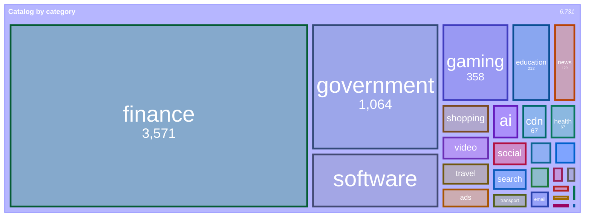
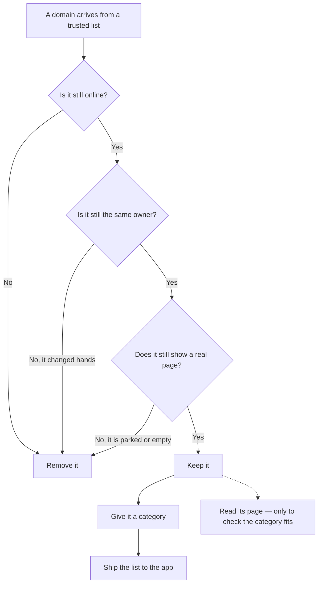
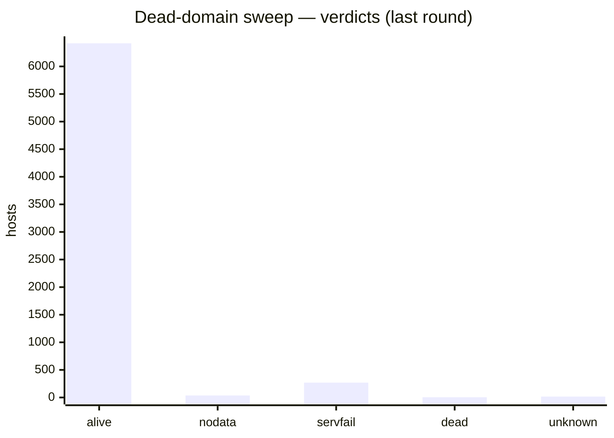

# Net Traffic Control — Catalog

**English** · [Türkçe](README.tr.md)

Category and service data for **Net Traffic Control**.

The app loads this file as a **Category Data source** (Settings → Category Data → Add
source). It maps host names to a **category** (what a name is) and to the
**service/product** it belongs to (whose it is), so the Live Traffic and Allowed
Sites screens group and label domains correctly.

<!-- catalog-badges:start -->

   

<!-- catalog-badges:end -->

## Contents

- **6,731 categories** — `host → category`.
- **22 services** — `product → hosts`.

See [`docs/CATALOG.md`](docs/CATALOG.md) for the breakdown by category.

## What is in it

The catalog by category, as a share of the whole — `finance` and `government`
are most of it, and the long tail is small on purpose. Each category is drawn in
the colour the iOS app uses for it, taken from `reference/category-colors.json`:

<!-- category-treemap:start -->



<!-- category-treemap:end -->

Regenerate it with `scripts/catalog/build-catalog-docs.py`, which writes these
blocks from `catalog.json`.

As a share of the whole, with the long tail folded into `other`:

<!-- category-pie:start -->


<!-- category-pie:end -->

## Pipeline — from a list to a kept host

A domain arrives from a trusted list. Three independent checks have to agree it
is still online and still the same owner before it keeps its place. If any check
is unsure, the domain stays — nothing is removed on a single signal, and a
removed name cannot quietly come back.



Two things are easy to confuse, so they are kept apart:

- **The category is a decision, not a guess.** A rule or a person sets it; the
  page is never asked to invent one. A name no rule matches is listed for a
  person in [`docs/NEEDS-REVIEW.md`](docs/NEEDS-REVIEW.md).
- **Reading the page is only a check.** It measures whether a category matches
  the page; it never writes the list. A low score means a label disagrees with
  its page, not that the label is wrong.

The three checks in the middle are the subject of the next section. The tools
behind them are [`probe-dead.py`](scripts/catalog/probe-dead.py),
[`verify-registrations.py`](scripts/catalog/verify-registrations.py) and
[`sweep-live.py`](scripts/analysis/sweep-live.py).

## How it is verified

A host is removed only when independent sweeps agree it is gone, and each host
is probed in two rounds before anything is removed. The DNS sweep below asks
three resolvers directly about `A`, `AAAA` and `NS` — nine questions — in two
rounds ten minutes apart, and only a host that answers `NXDOMAIN` to all nine in
both rounds is called dead. The browser sweep (agent-browser + Lightpanda)
checks what a host still serves, and the registration sweep checks RDAP/WHOIS/IP
to catch a name that changed hands.

<!-- verification-status:start -->



<!-- verification-status:end -->

Full method, evidence and the removal policy: [`scripts/README.md`](scripts/README.md).

## Format (v1)

```json
{
  "version": 1,
  "generated": "YYYY-MM-DD",
  "categories": { "<host>": "<category>" },
  "services": [
    { "key": "<id>", "name": "<Display Name>", "domains": ["<host>", "..."] }
  ]
}
```

### Fields

| Field | Type | Meaning |
| :--- | :--- | :--- |
| `version` | integer | Format version. Bumped only on a breaking change. |
| `generated` | string | Date the file was produced. Informational. |
| `categories` | object | `host → category` (a name from the vocabulary below). |
| `services` | array | One object per product; see below. |
| `services[].key` | string | Stable id the app may cache by. **Never renumber or reuse.** |
| `services[].name` | string | Display name (a product, not a company). |
| `services[].domains` | array | The hosts that belong to this product. |

### Matching

- A `categories` host matches itself **and every subdomain** — `facebook.com`
  covers `*.facebook.com`, so listing the registrable domain is enough.
- A `services` domain matches the same way — `microsoft.com` already covers
  `teams.microsoft.com`, and you do not list it again.
- Matching is case-insensitive.

## Categories

The vocabulary the app understands. A name outside this list is **ignored**.

```
analytics, ads, social, messaging, cdn, crash, video, music, gaming, shopping,
search, news, email, encyclopedia, software, ai, finance, government, health,
transport, telecom, travel, education, sports, crypto, dating, maps, adult,
gambling, other
```

`ipAddress` is also a category, but it is **not** a hostname category — it is what
the app files a literal address under, so it does not belong in this file.

## Services

One entry per **product**, not per company: **Facebook**, **Instagram**,
**WhatsApp** and **Threads** are separate entries on purpose. The app groups by the
product a domain belongs to, because a DNS filter sees domains, not apps — and a
product is what a person recognizes.

Example:

```json
{ "key": "twitter", "name": "Twitter / X",
  "domains": ["twitter.com", "x.com", "t.co", "twimg.com", "twttr.com"] }
```

A **role** (`api.`, `vpn.`, `dns.`) is *not* a service and does not belong here —
the app derives roles from the hostname and shows them as badges, so a role never
splits a product across groups.

## Precedence in the app

```
user correction  >  imported / remote data (this file)  >  bundled catalog
                 >  public-suffix rules  >  institutional label  >  name patterns
                 >  "other"
```

The **institutional-label** rule is the one between the suffix rules and the
patterns: it reads the label in front of a real country-code domain and calls
`ox.ac.uk` a university and `tokyo.lg.jp` a prefecture. It is a rule, not
content, so it lives in the app — but it sits in the chain, and a name that has
no row anywhere is decided by it before `"other"`.

A **user correction** outranks everything, including this file: the user looked
at the name and said otherwise, and the app treats that as a label, not a rule.

## Validation

- The app **tests a URL before adding it**: it fetches the file and runs the same
  validation the store uses, then reports **Valid · N entries** or the exact reason
  (not JSON, bad schema, empty, too large, 404, 5xx, no network).
- A failed or invalid download **never replaces the last working data**.

## Raw URL

```
https://raw.githubusercontent.com/mahirfatih/net-traffic-control-catalog/main/catalog.json
```

## Generating

`seeds/` is the source of truth (see [`scripts/`](scripts/README.md)); `catalog.json`
is the build output. Regenerate and validate:

```sh
python3 scripts/catalog/generate.py \
    --categories seeds/categories.json \
    --services   seeds/services.json \
    --out        catalog.json
python3 scripts/catalog/validate.py
```

Do not edit `catalog.json` by hand — edit `seeds/` instead.

To check the committed output is current without writing anything, use `--check`:
`generate.py --check` rebuilds from the seeds and compares with `catalog.json`,
and `build-catalog-docs.py --check` does the same for `docs/CATALOG.md` and the
marked README blocks. Neither needs git; `./test/test.sh` runs both.

Run everything — registry, schema, build, validator, docs, licence gate — with:

```sh
./test/test.sh
```

### Harvesting from an external source

An external list can tell you that a host exists. It cannot tell you what the
host *is*, so it never assigns a category: `harvest.py` proposes hosts and
`rules.json` (or a person) labels them.

```sh
python3 scripts/sources/harvest.py
python3 scripts/sources/merge.py evidence/harvested-categories.json --dry-run
python3 scripts/sources/merge.py evidence/harvested-categories.json
```

For broad imports, run the durable source audits before committing:

```sh
python3 scripts/sources/audit-source-import.py
python3 scripts/sources/review-source-live.py --source adguard-https-exclusions-banks --only weak --limit 200
```

`audit-source-import.py` is offline and runs in the test suite. It catches known
false positives and redundant same-category rows. `review-source-live.py` uses
DNS/HTTP and writes evidence under `evidence/`; use it for spot-checking weak or
new source rows. Source-specific review policies live in
`scripts/sources/source-policies.py`; add new broad-source policies there, then
move confirmed mistakes to `rules.json` → `drop.hosts`.

### Correcting one host by hand

A category that is wrong for a single host is a human decision, not a rule. Put
it in `rules.json` → `drop.override`, which **beats every rule and every source**:

```sh
python3 scripts/catalog/overrides.py set example.com shopping --reason "sells goods, not a bank"
python3 scripts/catalog/overrides.py list
python3 scripts/catalog/overrides.py remove example.com
python3 scripts/catalog/generate.py --categories seeds/categories.json --services seeds/services.json --out catalog.json
```

Precedence is fixed and enforced by code: **`override` > `rules` > harvested
source**. `generate.py` applies overrides last, `merge.py` never overwrites an
overridden host, and the audits treat an override as deliberate. Every override
needs a `reason`; `scripts/catalog/overrides.py check` (run by the test suite)
refuses one without it, one outside the vocabulary, or one that is also in
`drop.hosts`.

### Removing a host that no longer exists

A domain that stops resolving is not harmless dead weight: it can be bought by
somebody else and keep the category the previous owner had. Removing one is a
correctness fix. The hard part is that *unreachable* and *dead* look identical
from inside this network — a firewall that drops NXDOMAIN-only names, a captive
portal and a lapsed domain all answer the same way. Nearly all of the AdGuard
banks look unreachable from here, and 181 real banks were almost dropped on
that evidence.

So `scripts/catalog/probe-dead.py` asks the resolvers directly and reads the
response code they return, which settles it:

```sh
python3 scripts/catalog/probe-dead.py --self-test
python3 scripts/catalog/probe-dead.py --round 1     # ~11 minutes, 6,731 hosts
python3 scripts/catalog/probe-dead.py --round 2     # 10 minutes later, minimum enforced
python3 scripts/catalog/probe-dead.py --summary
```

Cloudflare, Google and AdGuard are each asked about A, AAAA and NS, so a host
has nine chances to prove it is alive and has to fail all nine to be called
dead — in **both** rounds. Round 2 refuses to run until the minimum gap has
passed, because a resolver outage is a snapshot the same way a dead name is.

The summary prints a **proposal**. It is not a deletion: applying it means adding
the host to `rules.json` → `drop.hosts` with a reason that cites the evidence.
Two verdicts are never proposed for removal, by design:

- **`nodata`** — `NOERROR` with no address record. The name exists; a mail-only
  domain looks exactly like this.
- **`servfail`** — every resolver says the zone is broken. Usually a lapsed
  registration, so it is reported under "Worth a look", but a broken zone is not
  proof of anything.

The script is deliberately absent from `test/test.sh`: it needs the network, and
CI must never depend on a network to tell a real bank it is dead. See
`docs/SOURCES.md` for the full workflow.

### Removing a host that still resolves but serves nothing

DNS is not the whole story: a name can keep resolving after its site has gone.
`scripts/analysis/sweep-live.py` visits every host with a real browser
([agent-browser](https://github.com/vercel-labs/agent-browser) driving
[Lightpanda](https://lightpanda.io) with `--engine lightpanda`) and proposes the
hosts that answer with nothing — a parked page, an empty shell, a 404:

```sh
python3 scripts/analysis/sweep-live.py --self-test
python3 scripts/analysis/sweep-live.py --round 1 --aggressive
python3 scripts/analysis/sweep-live.py --round 2 --aggressive
python3 scripts/analysis/sweep-live.py --summary --aggressive   # proposal only
python3 scripts/analysis/sweep-live.py --apply --aggressive     # only after you read it
```

Two rounds must agree, the proposal is cross-checked against the DNS sweep above,
and a failure is only believed after a canary proves the browser still works —
because a long sweep is far more likely to lose its engine than to meet thousands
of dead hosts. A host that answered with a certificate failure or a timeout is
reported for review, never proposed: that says this network could not reach it,
not that the host is empty. By default only a **parked** host is proposed;
`--aggressive` widens that to hosts that answered with no page at all, which is
common on live infrastructure — `adnxs.com` and `3dsecure.akbank.com.tr` both
answer with nothing and both belong in a DNS-filter catalog — so the proposal is
meant to be read, not applied blind. The script needs the network and a
`lightpanda` binary, so it stays out of `test/test.sh`, like the DNS sweep.
Method and tools: [`scripts/analysis/`](scripts/analysis/README.md).

### Verifying a host is still the same owner

DNS and a browser can both say a name is "alive" while it has changed hands: a
lapsed domain is re-registered by someone else and inherits the previous owner's
category. `scripts/catalog/verify-registrations.py` checks the registration
itself:

1. **RDAP** for the domain (IANA bootstrap + verified cc supplement + convention
   probing).
2. **Port-43 WHOIS** fallback for registries with no RDAP (DENIC `.de`,
   TRABIS `.tr`, and anything IANA refers to).
3. **IP RDAP** for the host's address block (ARIN/RIPE/...), so the network
   owner is on record.
4. **traceroute** as a bounded reachability diagnostic (unprivileged on macOS).

```sh
python3 scripts/catalog/verify-registrations.py --self-test
python3 scripts/catalog/verify-registrations.py --round 1
python3 scripts/catalog/verify-registrations.py --round 2     # 10 minutes later
python3 scripts/catalog/verify-registrations.py --summary
```

The same discipline applies: a canary before the run, two rounds that must agree,
and a host is only proposed on a strong signal (`gone`, `expired`). Unknown and
unsupported TLDs are reported, never deleted. Reference data:
[`reference/rdap/`](reference/rdap/README.md). Method and tools:
[`scripts/catalog/`](scripts/catalog/README.md).

Rules for a generator:

- **Output must use our vocabulary** (see above). An unknown category is not
  reported by the app — it is silently ignored, so `validate.py` fails the
  build instead.
- **`key` must stay stable.** The app may cache by it; changing a key re-labels data.
- **Deterministic output** (sorted keys) so diffs stay reviewable.
- **Only permitted sources**, enforced in code rather than by convention: every
  source lives in [`sources.json`](sources.json) with its licence, and
  [`scripts/sources/sources.py`](scripts/sources/sources.py) refuses a non-commercial or
  share-alike licence *before* fetching it. See
  [`docs/SOURCES.md`](docs/SOURCES.md) for the reasoning, and
  [`SECURITY.md`](SECURITY.md) for why it is a gate rather than a note.

## Contributing

- Add entries by hand, or with a generator.
- Every entry should be **traceable to a source** — a wrong label is worse than no
  label, because it looks authoritative.
- Category names must be from the vocabulary; anything else is ignored by the app.
- Keep `services` at the **product** level (Facebook, Instagram, WhatsApp are
  separate), not the parent company.
- Keep the file sorted by host so diffs stay small.
- **Do not commit NonCommercial or share-alike data.** `NC` forbids use in a
  commercial app and `SA` would stop the derivative being CC0 — the two terms in
  `CC BY-NC-SA 4.0`. This is no longer a convention:
  [`sources.json`](sources.json) records the licence of every source and
  [`scripts/sources/sources.py`](scripts/sources/sources.py) refuses the blocked ones before
  fetching, and `./test/test.sh` fails if a record claims otherwise.

Full guide: [`CONTRIBUTING.md`](CONTRIBUTING.md).

## Versioning

- The app reads `version`; it accepts the versions it knows and ignores the rest.
- Unknown fields and unknown category names are ignored, never fatal.
- `version` is bumped only on a breaking format change.

## Catalog Consistency Analysis

A one-off analysis ([`scripts/analysis/`](scripts/analysis/), results in
[`docs/analysis/`](docs/analysis/)) fetches homepage text for catalog hosts,
compares TF-IDF text classifiers, keeps LinearSVC for the detailed audit, and
renders a confusion matrix showing how consistently our labels agree with what a
text model can recover.


**Accuracy: 89%** (4,045/4,565, 27 classes, 3-fold CV) — **balanced accuracy
60%**. `finance` is 53% of the catalog, so the two numbers differ by 29 points
and the second is the meaningful one: roughly two of every three labels cannot
be recovered from page text, which accuracy hides.

This measures *self-consistency*, not correctness — it shows whether our labels
are predictable from page content. High diagonal = our labels are predictable
from page text. Off-diagonal = our label disagrees with what the text suggests
(either the label is wrong, or the page is not representative of the category).

All 27 categories are measured, including the small ones. Model comparison:
LinearSVC 0.886 / 0.595, LogisticRegression 0.862 / 0.576,
MultinomialNB 0.605 / 0.166 (accuracy / balanced accuracy).

- **Highest F1:** `government` 0.97, `finance` 0.96, `education` 0.92, `news`
  0.86, `email` 0.72. These categories have strong, distinctive page signals.
- **Lowest F1:** `crypto` 0.19, `encyclopedia` 0.31, `cdn` 0.35, `music` 0.40,
  `video` 0.41, `social` 0.41 — some of these are infrastructure (page text is
  meaningless or ambiguous). Correlated terms and model-weight terms reveal
  potential miscategorizations.
- **Thin evidence:** eight categories have under 20 examples, so their F1 is
  indicative rather than measured — `maps` 3, `sports` 7, `music` 8, `crypto` 8,
  `other` 10, `crash` 11, `telecom` 11, `email` 19. This is why the matrix is
  3-fold, not 5.
- **Coverage is 68%, and unevenly spread:** 4,565 of 6,745 hosts yield usable
  page text. The failures cluster in canvas/JS-heavy categories — `gaming` is
  measured on 69 hosts of 360 (19%), `software` 168 of 476 (35%) — while
  static ones do well (`government` 87%, `news` 88%). Every per-class score
  describes the hosts that produced text, not the category. Full table in
  [`docs/analysis/README.md`](docs/analysis/README.md).
- **High-confidence errors:** 5 hosts, four of them labelled `finance` —
  `guven.com.tr` (→ `health`, 87%), `display.ugc.bazaarvoice.com` (→ `finance`,
  82%), `iqiyi.com` (→ `finance`, 82%), `ilbank.gov.tr` (→ `government`, 72%)
  and `paypalobjects.com` (→ `music`, 71%). `finance` is over half the sample, so
  it is both where the model falls back to and where it drifts from.

See [`docs/analysis/README.md`](docs/analysis/README.md) for full methodology,
per-class metrics, correlated terms (chi-squared + LinearSVC weights), and the
error list.

## License

The data in this repository is dedicated to the public domain under **CC0 1.0
Universal**. See [LICENSE](LICENSE).
