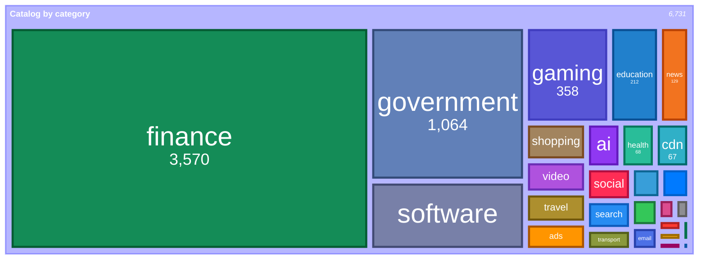
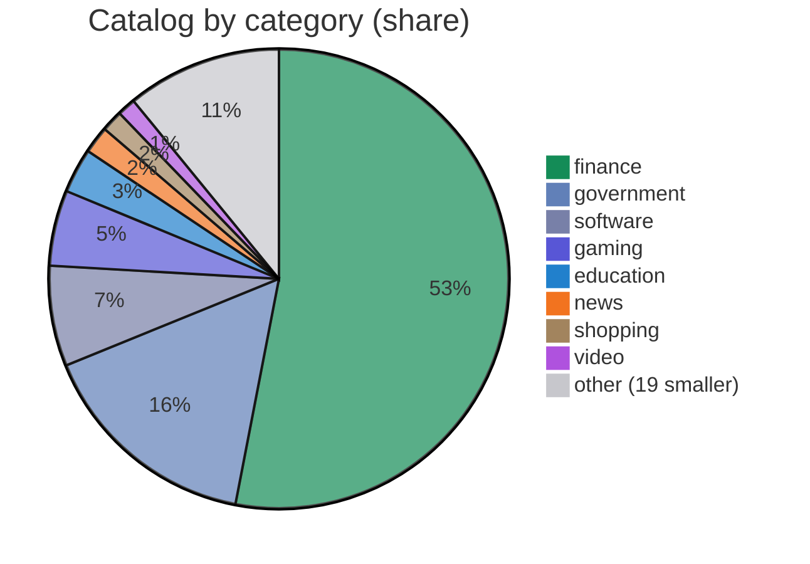
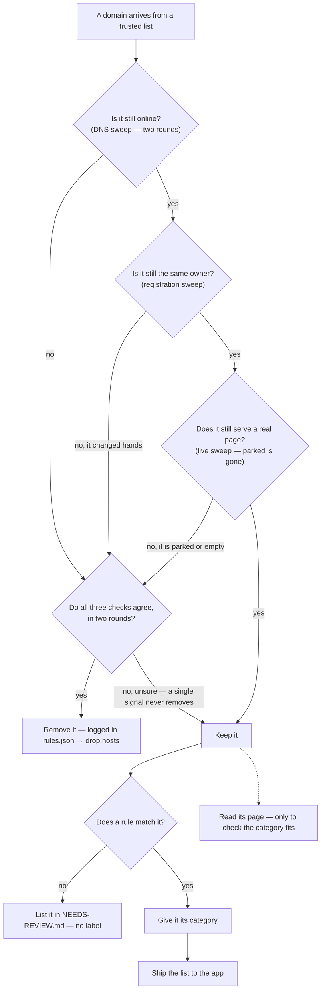
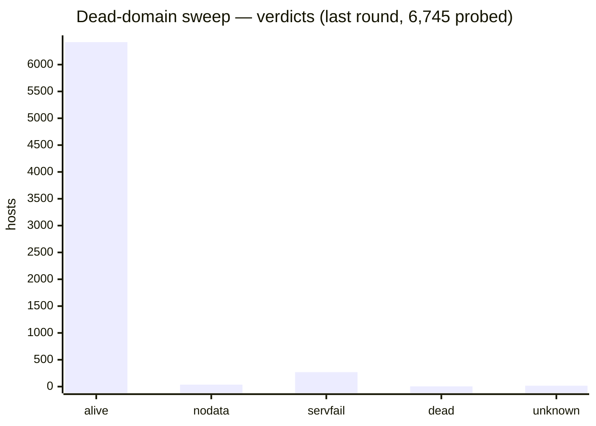

# Net Traffic Control — Catalog

**English** · [Türkçe](README.tr.md)

[](https://github.com/mahirfatih/net-traffic-control-catalog/actions/workflows/ci.yml)


Category and service data for **Net Traffic Control**.

The app loads this file as a **Category Data source** (Settings → Category Data → Add
source). It maps host names to a **category** (what a name is) and to the
**service/product** it belongs to (whose it is), so the Live Traffic and Allowed
Sites screens group and label domains correctly.

<!-- catalog-badges:start -->

   

<!-- catalog-badges:end -->

## Contents

- **6,731 hosts** — `host → category`.
- **22 services** — `product → hosts`.

See [`docs/CATALOG.md`](docs/CATALOG.md) for the breakdown by category, and
[`docs/COVERAGE.md`](docs/COVERAGE.md) for how much of it the analysis can
actually read — and which source carries which category.

## What is in it

The catalog by category, as a share of the whole — `finance` and `government`
are most of it, and the long tail is small on purpose. Each category is drawn in
the colour the iOS app uses for it, taken from `reference/category-colors.json`:

<!-- category-treemap:start -->



<!-- category-treemap:end -->

Regenerate it with `scripts/catalog/build-catalog-docs.py`, which writes these
blocks from `catalog.json`.

Two different `other`s appear on this page, and they are not the same number: the
treemap's `other` is the literal `other` category (14 hosts), while the pie's
`other (19 smaller)` is the 19 smallest categories folded together (733 hosts).

As a share of the whole, with the long tail folded into `other`:

<!-- category-pie:start -->



<!-- category-pie:end -->

## Pipeline — from a list to a kept host

A domain arrives from a trusted list. Three independent checks have to agree it
is still online and still the same owner before it keeps its place. If any check
is unsure, the domain stays — nothing is removed on a single signal, and a
removed name cannot quietly come back.



The three checks are **independent** and the gate is an **intersection**: a
host is proposed only when every check, in two rounds, agrees it should go.
By default the live sweep proposes only `parked` — an empty 200 or a 404 is
common on live infrastructure (`adnxs.com`, `3dsecure.akbank.com.tr`). Full
method, every verdict and the guardrails: [`docs/PIPELINE.md`](docs/PIPELINE.md).

Two things are easy to confuse, so they are kept apart:

- **The category is a decision, not a guess.** A rule or a person sets it; the
  page is never asked to invent one. A name no rule matches is listed for a
  person in [`docs/NEEDS-REVIEW.md`](docs/NEEDS-REVIEW.md).
- **Reading the page is only a check.** It measures whether a category matches
  the page; it never writes the list. A low score means a label disagrees with
  its page, not that the label is wrong.
- **Not every host came from a list.** A host enters through one of three doors —
  a source, the public-institution harvester, or a person's hand — and nothing
  names the last two. [`docs/FOUNDING.md`](docs/FOUNDING.md) accounts for the
  hosts that came from neither a rule nor a source.

The three checks in the middle are the subject of the next section. The tools
behind them are [`probe-dead.py`](scripts/catalog/probe-dead.py),
[`verify-registrations.py`](scripts/catalog/verify-registrations.py) and
[`sweep-live.py`](scripts/analysis/sweep-live.py).

How a category is decided — the three doors a host can arrive through — is in
[`docs/INGEST.md`](docs/INGEST.md). The removal machinery — the nine DNS
questions, every verdict, and the guardrails behind them — is in
[`docs/PIPELINE.md`](docs/PIPELINE.md); how often each sweep should run is in
[`docs/SCHEDULE.md`](docs/SCHEDULE.md).

## How presence is verified

This verifies that a host is still **there** — online, still the same owner,
still serving a page. It does **not** verify that its *category* is correct.
That is a separate question, and it is answered by the
[Catalog Consistency Analysis](#catalog-consistency-analysis) below, not here.

A host is removed only when independent sweeps agree it is gone, and each host
is probed in two rounds before anything is removed. The DNS sweep below asks
**Cloudflare**, **Google** and **AdGuard** (its *unfiltered* endpoint — the default
one answers blocked ad and tracker names with `0.0.0.0`, so measuring through it
would be measuring its own blocklist) directly about `A`, `AAAA` and `NS` — nine
questions — in two rounds ten minutes apart, and only a host that answers `NXDOMAIN`
to all nine in both rounds is called dead. When every resolver says `SERVFAIL`
the sweep asks once more with checking disabled, so a DNSSEC validation failure is
not mistaken for a delegation that never worked. The browser sweep
(agent-browser + Lightpanda) checks what a host still serves, and the registration
sweep checks RDAP/WHOIS/IP to catch a name that changed hands.

<!-- verification-status:start -->



<!-- verification-status:end -->

The last round probes the sweep's own list, which still holds hosts already
removed through `rules.json → drop.hosts` — so its total need not equal the
catalog's. Full method, evidence and the removal policy:
[`scripts/README.md`](scripts/README.md).

## Format and maintaining

The file format — the schema, the matching rules, the vocabulary and the
precedence order — is in [`docs/FORMAT.md`](docs/FORMAT.md). How to generate,
add, correct and remove a host, and the discipline behind it, is in
[`docs/MAINTAINING.md`](docs/MAINTAINING.md).

The catalog is served raw from:

```
https://raw.githubusercontent.com/mahirfatih/net-traffic-control-catalog/main/catalog.json
```

## Catalog Consistency Analysis

The catalog's only quantitative quality signal, rebuilt with each release
([`scripts/analysis/`](scripts/analysis/), results in
[`docs/analysis/`](docs/analysis/)): it fetches homepage text for catalog hosts,
compares nine text classifiers — eight on TF-IDF features and one on
multilingual sentence embeddings — keeps LinearSVC as the audit witness, and
renders a confusion matrix showing how consistently our labels agree with what a
text model can recover.


**Accuracy: 89%** (4,054/4,563, 27 classes, 3-fold CV) — **balanced accuracy
61%**. `finance` is 53% of the catalog, so the two numbers differ by 28 points
and the second is the meaningful one: it is the mean per-class recall, so on
average about two in five *per-category* recognitions are lost when the model
meets a category it rarely sees — a cost accuracy hides.

This measures *self-consistency*, not correctness — it shows whether our labels
are predictable from page content. High diagonal = our labels are predictable
from page text. Off-diagonal = our label disagrees with what the text suggests
(either the label is wrong, or the page is not representative of the category).

All 27 categories are measured, including the small ones. Nine models were
compared on the same folds — eight on TF-IDF bag-of-words features and one on
multilingual sentence embeddings — and LinearSVC is kept as the audit witness:

| model | accuracy | balanced acc | macro-F1 | weighted-F1 |
| --- | ---: | ---: | ---: | ---: |
| MultilingualEmbeddingLogReg | 0.852 | 0.666 | 0.585 | 0.866 |
| RidgeClassifier | 0.864 | 0.637 | 0.566 | 0.876 |
| LinearSVC | 0.888 | 0.605 | 0.592 | 0.890 |
| SGDClassifier | 0.889 | 0.584 | 0.589 | 0.889 |
| LogisticRegression | 0.865 | 0.580 | 0.557 | 0.874 |
| RandomForestClassifier | 0.821 | 0.523 | 0.506 | 0.840 |
| KNeighborsClassifier | 0.856 | 0.444 | 0.513 | 0.839 |
| DecisionTreeClassifier | 0.797 | 0.395 | 0.391 | 0.800 |
| MultinomialNB | 0.603 | 0.164 | 0.165 | 0.649 |

The table is sorted by balanced accuracy and is descriptive, not a leaderboard.
LinearSVC stays the witness: it has the highest macro-F1 of the nine, and its
coefficients are what the correlated-terms report reads. Two models beat it on
balanced accuracy — `MultilingualEmbeddingLogReg` 0.666 and `RidgeClassifier`
0.637, both at a cost in macro-F1 — while the non-linear heads trail on sparse
lexical features (`KNeighborsClassifier` is also the one model with no
`class_weight` to balance it). The embedding edge is the interesting one: it
maps Turkish, German, Korean and Chinese pages into one space, so it recovers
the small, non-English categories that bag-of-words keeps apart.

- **Highest F1:** `government` 0.97, `finance` 0.96, `education` 0.91, `news`
  0.85 — strong, distinctive page signals. (`email` also scores 0.79, but on only
  19 hosts, so it stays out of this list; see below.)
- **Lowest F1:** `crypto` 0.29, `encyclopedia` 0.31, `cdn` 0.35, `music` 0.40,
  `social` 0.40, `video` 0.41 — some of these are infrastructure (page text is
  meaningless or ambiguous). Correlated terms and model-weight terms reveal
  potential miscategorizations.
- **Thin evidence:** eight categories have under 20 examples, so their F1 is
  indicative rather than measured — `maps` 3, `sports` 7, `music` 8, `crypto` 8,
  `other` 10, `crash` 11, `telecom` 11, `email` 19. `email`'s 0.79 would look
  "highest" only by ignoring how thin it is, which is why it is kept off the
  list above. This is why the matrix is 3-fold, not 5.
- **Coverage is 68%, and unevenly spread:** 4,563 of 6,731 hosts yield usable
  page text. The failures cluster in canvas/JS-heavy categories — `gaming` is
  measured on 69 hosts of 358 (19%), `software` 168 of 476 (35%) — while
  static ones do well (`government` 87%, `news` 89%). Every per-class score
  describes the hosts that produced text, not the category. Full table in
  [`docs/analysis/README.md`](docs/analysis/README.md).
- **High-confidence errors:** 68 hosts — the model is ≥70% sure and the label
  disagrees. The list is computed out of fold, like the matrix; the four it
  listed before (`display.ugc.bazaarvoice.com` `software` → `finance` 82%,
  `iqiyi.com` `video` → `finance` 82%, `googlesyndication.com` `ads` → `search`
  83%, `ilbank.gov.tr` `finance` → `government` 87%) are still there, joined by
  the hosts the in-sample probabilities had hidden. 57 of the 68 predict `finance`
  — the label is 53% of the catalog and the model's fallback. Full list in
  [`docs/analysis/out/high-confidence-errors.md`](docs/analysis/out/high-confidence-errors.md).

See [`docs/analysis/README.md`](docs/analysis/README.md) for full methodology,
per-class metrics, correlated terms (chi-squared + LinearSVC weights), and the
error list.

## License

The data in this repository is dedicated to the public domain under **CC0 1.0
Universal**. See [LICENSE](LICENSE).
