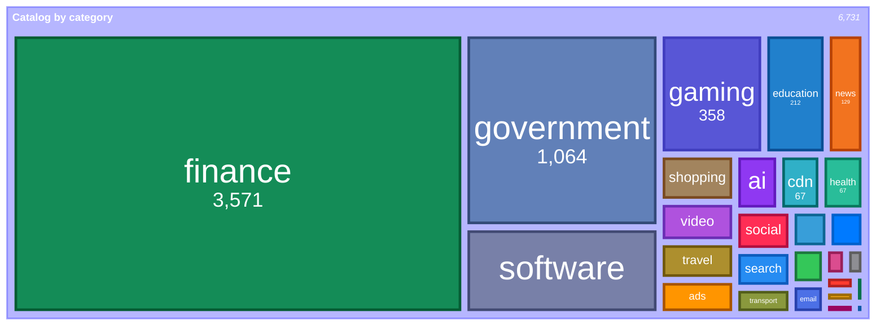
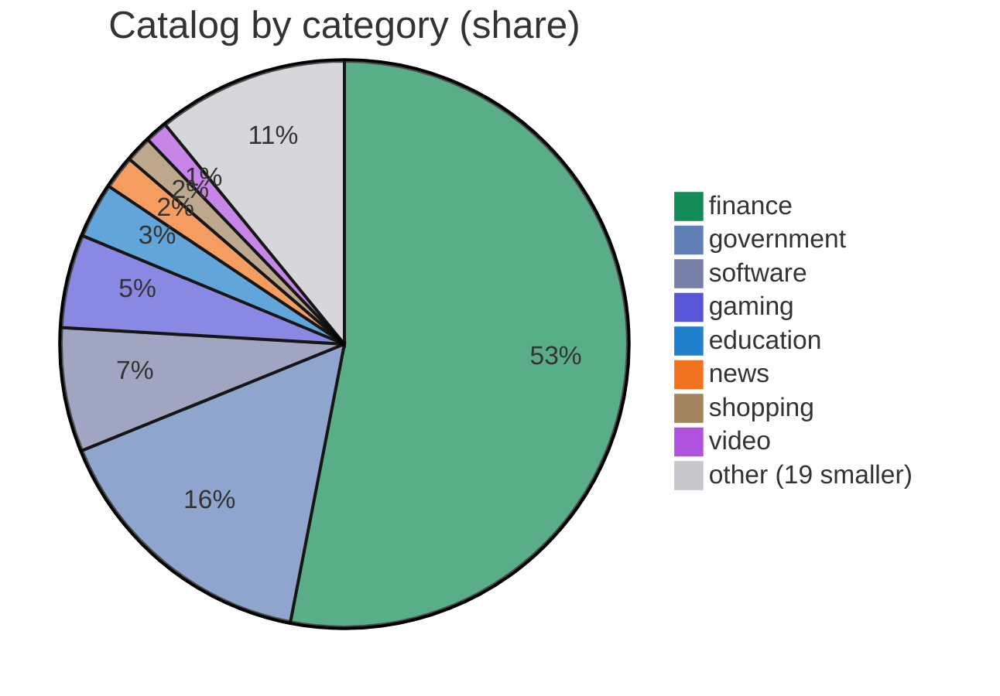
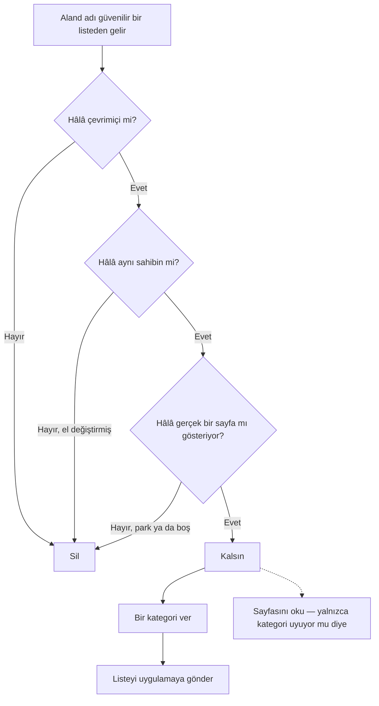
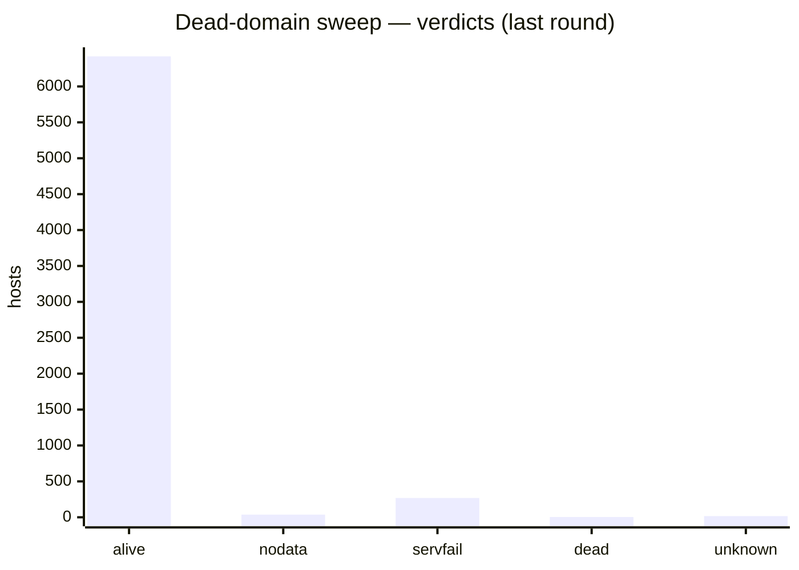

# Net Traffic Control — Catalog

[English](README.md) · **Türkçe**

**Net Traffic Control** için kategori ve servis verisi.

Uygulama bu dosyayı bir **Category Data source** olarak yükler (Settings → Category
Data → Add source). Host adlarını bir **kategoriye** (adın ne olduğu) ve ait
olduğu **servise/ürüne** (kimin olduğu) eşler; böylece Live Traffic ve Allowed
Sites ekranları alan adlarını doğru gruplar ve etiketler.

<!-- catalog-badges:start -->

   

<!-- catalog-badges:end -->

## İçindekiler

- **6,731 kategori** — `host → kategori`.
- **22 servis** — `ürün → host`.

Kategoriye göre döküm için [`docs/CATALOG.md`](docs/CATALOG.md).

## İçinde ne var

Kataloğun kategoriye göre dağılımı, bütünün payı olarak — `finance` ve
`government` çoğunluğu oluşturur, uzun kuyruk bilerek küçüktür. Her kategori,
iOS uygulamasının kullandığı renkle çizilir; bu renkler
`reference/category-colors.json`'dan alınır:

<!-- category-treemap:start -->



<!-- category-treemap:end -->

Bu blokları `catalog.json`'dan `scripts/catalog/build-catalog-docs.py` yazar;
onunla yeniden üret.

Bütünün payı olarak, uzun kuyruk `other` altında toplanmış:

<!-- category-pie:start -->



<!-- category-pie:end -->

## Akış — listeden kataloğa giren bir alan adı

Bir alan adı güvenilir bir listeden gelir. Yerini koruması için üç bağımsız
kontrolün onu hâlâ çevrimiçi ve hâlâ aynı sahipte bulması gerekir. Kontrollerden
biri emin değilse alan adı kalır — tek bir sinyalle hiçbir şey silinmez ve
silinen bir ad sessizce geri gelemez.



Karışması kolay iki şey ayrı tutulur:

- **Kategori bir karardır, tahmin değil.** Onu bir kural ya da bir kişi belirler;
  sayfaya asla kategori uydurtulmaz. Hiçbir kuralın eşlemediği bir ad, bir kişi
  için [`docs/NEEDS-REVIEW.md`](docs/NEEDS-REVIEW.md) içinde listelenir.
- **Sayfayı okumak yalnızca bir kontroldür.** Kategorinin sayfayla uyup
  uymadığını ölçer; listeyi asla yazmaz. Düşük skor, etiketin sayfayla
  çeliştiğini söyler; etiketin yanlış olduğunu değil.

Ortadaki üç kontrol bir sonraki bölümün konusudur. Arkalarındaki araçlar:
[`probe-dead.py`](scripts/catalog/probe-dead.py),
[`verify-registrations.py`](scripts/catalog/verify-registrations.py) ve
[`sweep-live.py`](scripts/analysis/sweep-live.py).

Tam ayrıntı — dokuz DNS sorusu, her verdict ve arkalarındaki koruma kuralları —
[`docs/PIPELINE.md`](docs/PIPELINE.md) içinde.

## Nasıl doğrulanır

Bir host, yalnızca bağımsız taramalar onun gittiğinde anlaştığında silinir; her
host silinmeden önce iki turda yoklanır. Aşağıdaki DNS taraması üç çözümleyiciye
doğrudan `A`, `AAAA` ve `NS` sorar — dokuz soru — on dakika arayla iki turda; ve
yalnızca dokuzunun hepsine **her iki turda da** `NXDOMAIN` yanıtını veren host
ölü sayılır. Tarayıcı taraması (agent-browser + Lightpanda) bir host'un hâlâ ne
sunduğuna bakar; kayıt taraması ise el değiştiren bir adı yakalamak için
RDAP/WHOIS/IP kontrol eder.

<!-- verification-status:start -->



<!-- verification-status:end -->

Tam yöntem, kanıt ve kaldırma politikası: [`scripts/README.md`](scripts/README.md).

## Format (v1)

```json
{
  "version": 1,
  "generated": "YYYY-MM-DD",
  "categories": { "<host>": "<category>" },
  "services": [
    { "key": "<id>", "name": "<Display Name>", "domains": ["<host>", "..."] }
  ]
}
```

### Alanlar

| Alan | Tür | Anlam |
| :--- | :--- | :--- |
| `version` | tam sayı | Format sürümü. Yalnızca kırıcı bir değişiklikte artırılır. |
| `generated` | metin | Dosyanın üretildiği tarih. Bilgilendirici. |
| `categories` | nesne | `host → kategori` (aşağıdaki sözlükten bir ad). |
| `services` | dizi | Ürün başına bir nesne; aşağıya bak. |
| `services[].key` | metin | Uygulamanın önbelleğe alabileceği sabit kimlik. **Asla yeniden numaralandırma veya yeniden kullanma.** |
| `services[].name` | metin | Görünen ad (bir şirket değil, bir ürün). |
| `services[].domains` | dizi | Bu ürüne ait host'lar. |

### Eşleşme

- `categories` içindeki bir host **kendisiyle ve her alt alan adıyla** eşleşir —
  `facebook.com`, `*.facebook.com`'u kapsar; kayıtlanabilir alan adını listelemek
  yeter.
- `services` içindeki bir alan adı da aynı şekilde eşleşir — `microsoft.com`,
  `teams.microsoft.com`'u zaten kapsar; onu bir daha listelemezsin.
- Eşleşme büyük/küçük harf duyarsızdır.

## Kategoriler

Uygulamanın anladığı sözlük. Bu listenin dışındaki bir ad **yok sayılır**.

```
analytics, ads, social, messaging, cdn, crash, video, music, gaming, shopping,
search, news, email, encyclopedia, software, ai, finance, government, health,
transport, telecom, travel, education, sports, crypto, dating, maps, adult,
gambling, other
```

`ipAddress` de bir kategoridir ama bir hostname kategorisi **değildir** —
uygulamanın düz bir adresi dosyaladığı kategoridir; bu yüzden bu dosyada yeri
yoktur.

## Servisler

Şirket başına değil, **ürün** başına bir kayıt: **Facebook**, **Instagram**,
**WhatsApp** ve **Threads** bilerek ayrı kayıtlardır. Uygulama bir alan adının ait
olduğu ürüne göre gruplar, çünkü bir DNS filtresi uygulamaları değil alan
adlarını görür — ve bir kişinin tanıdığı şey üründür.

Örnek:

```json
{ "key": "twitter", "name": "Twitter / X",
  "domains": ["twitter.com", "x.com", "t.co", "twimg.com", "twttr.com"] }
```

Bir **rol** (`api.`, `vpn.`, `dns.`) bir servis *değildir* ve burada yer almaz —
uygulama rolleri hostname'den türetir ve badge olarak gösterir; böylece bir rol
bir ürünü asla gruplar arasında bölmez.

## Uygulamadaki öncelik

```
kullanıcı düzeltmesi  >  içe/uzak veri (bu dosya)  >  paketlenmiş katalog
                      >  public-suffix kuralları  >  kurumsal etiket  >  ad desenleri
                      >  "other"
```

**Kurumsal-etiket** kuralı, suffix kuralları ile desenler arasındakidir: gerçek
bir ülke-kodu alan adının önündeki etiketi okur ve `ox.ac.uk`'yi üniversite,
`tokyo.lg.jp`'yi vilayet sayar. Bu bir kuraldır, içerik değil; bu yüzden
uygulamada yaşar — ama zincirde durur ve hiçbir yerde satırı olmayan bir adı
`"other"`'dan önce o belirler.

Bir **kullanıcı düzeltmesi** her şeyin üstündedir, bu dosya dahil: kullanıcı ada
bakıp aksini söylediyse uygulama bunu bir kural değil, bir etiket sayar.

## Doğrulama

- Uygulama **URL'yi eklemeden önce test eder**: dosyayı indirir ve mağazanın
  kullandığı doğrulamanın aynısını çalıştırır, ardından **Valid · N entries** ya
  da kesin nedeni (JSON değil, bozuk şema, boş, çok büyük, 404, 5xx, ağ yok)
  bildirir.
- Başarısız ya da geçersiz bir indirme, son çalışan veriyi **asla değiştirmez**.

## Ham URL

```
https://raw.githubusercontent.com/mahirfatih/net-traffic-control-catalog/main/catalog.json
```

## Üretme

`seeds/` doğru kaynaktır ([`scripts/`](scripts/README.md)); `catalog.json` ise
derleme çıktısıdır. Yeniden üret ve doğrula:

```sh
python3 scripts/catalog/generate.py \
    --categories seeds/categories.json \
    --services   seeds/services.json \
    --out        catalog.json
python3 scripts/catalog/validate.py
```

`catalog.json`'u elle düzenleme — bunun yerine `seeds/` düzenle.

Hiçbir şey yazmadan commit'li çıktının güncel olup olmadığını kontrol etmek için
`--check` kullan: `generate.py --check` seeds'ten yeniden üretip `catalog.json`
ile karşılaştırır; `build-catalog-docs.py --check` aynısını `docs/CATALOG.md` ve
işaretli README blokları için yapar. İkisi de git gerektirmez; `./test/test.sh`
ikisini de çalıştırır.

Her şeyi — kayıt, şema, derleme, doğrulayıcı, dokümanlar, lisans kapısı —
şununla çalıştır:

```sh
./test/test.sh
```

### Harici bir kaynaktan toplama

Harici bir liste bir host'un var olduğunu söyleyebilir. Host'un *ne olduğunu*
söyleyemez; bu yüzden asla kategori atamaz: `harvest.py` host önerir,
`rules.json` (ya da bir kişi) onları etiketler.

```sh
python3 scripts/sources/harvest.py
python3 scripts/sources/merge.py evidence/harvested-categories.json --dry-run
python3 scripts/sources/merge.py evidence/harvested-categories.json
```

Geniş alımlar için commit'ten önce kalıcı kaynak denetimlerini çalıştır:

```sh
python3 scripts/sources/audit-source-import.py
python3 scripts/sources/review-source-live.py --source adguard-https-exclusions-banks --only weak --limit 200
```

`audit-source-import.py` çevrimdışıdır ve test paketinde çalışır. Bilinen
yanlış-pozitifleri ve aynı kategoride yinelenen satırları yakalar.
`review-source-live.py` DNS/HTTP kullanır ve `evidence/` altına kanıt yazar; zayıf
veya yeni kaynak satırlarını gözden geçirmek için kullan. Kaynağa özel inceleme
politikaları `scripts/sources/source-policies.py` içindedir; yeni geniş-kaynak
politikalarını oraya ekle, sonra doğrulanmış hataları `rules.json` → `drop.hosts`
altına taşı.

### Tek bir host'u elle düzeltme

Tek bir host için yanlış olan kategori bir insan kararıdır, kural değil. Onu
`rules.json` → `drop.override` içine koy; bu **her kuralı ve her kaynağı yener**:

```sh
python3 scripts/catalog/overrides.py set example.com shopping --reason "sells goods, not a bank"
python3 scripts/catalog/overrides.py list
python3 scripts/catalog/overrides.py remove example.com
python3 scripts/catalog/generate.py --categories seeds/categories.json --services seeds/services.json --out catalog.json
```

Öncelik sabittir ve kod tarafından zorlanır: **`override` > `rules` > toplanan
kaynak**. `generate.py` override'ları en son uygular, `merge.py` override edilmiş
bir host'un üstüne asla yazmaz ve denetimler override'ı bilinçli sayar. Her
override bir `reason` ister; `scripts/catalog/overrides.py check` (test paketinde
çalışır) gerekçesizi, sözlük dışını ya da hem `drop.hosts`'ta hem burada olanı
reddeder.

### Artık var olmayan bir host'u kaldırma

Çözülmeyi bırakan bir alan adı zararsız ölü ağırlık değildir: başkası satın alıp
önceki sahibin kategorisini koruyabilir. Birini kaldırmak bir doğruluk
düzeltmesidir. Zor kısım, bu ağın içinden *erişilemez* ile *ölü*'nün aynı
görünmesidir — yalnızca NXDOMAIN adlarını düşüren bir güvenlik duvarı, bir
captive portal ve süresi geçmiş bir alan adı aynı şekilde yanıt verir. AdGuard
bankalarının neredeyse hepsi buradan erişilemez görünür ve bu kanıtla 181 gerçek
banka neredeyse silinecekti.

Bu yüzden `scripts/catalog/probe-dead.py` çözümleyicilere doğrudan sorar ve
döndürdükleri yanıt kodunu okur; bu da işi bitirir:

```sh
python3 scripts/catalog/probe-dead.py --self-test
python3 scripts/catalog/probe-dead.py --round 1     # ~11 minutes, 6,731 hosts
python3 scripts/catalog/probe-dead.py --round 2     # 10 minutes later, minimum enforced
python3 scripts/catalog/probe-dead.py --summary
```

Cloudflare, Google ve AdGuard'a A, AAAA ve NS sorulur; yani bir host'un canlı
olduğunu kanıtlamak için dokuz şansı vardır ve ölü sayılmak için dokuzunun
hepsini **her iki turda da** kaybetmelidir. Round 2, minimum süre geçmeden
çalışmayı reddeder, çünkü bir çözümleyici kesintisi de tıpkı ölü bir ad gibi bir
enstantanedir.

Özet bir **öneri** yazdırır. Bu bir silme değildir: onu uygulamak, host'u kanıta
atıfla birlikte `rules.json` → `drop.hosts` içine eklemek demektir. İki sonuç
tasarım gereği asla kaldırma için önerilmez:

- **`nodata`** — adres kaydı olmayan `NOERROR`. Ad var; yalnızca postaya hizmet
  eden bir alan adı tam böyle görünür.
- **`servfail`** — her çözümleyici zone'un bozuk olduğunu söyler. Genelde süresi
  geçmiş bir kayıttır; bu yüzden "Göz atmaya değer" altında raporlanır, ama bozuk
  bir zone hiçbir şeyin kanıtı değildir.

Script `test/test.sh`'ten bilerek çıkarılmıştır: ağa ihtiyaç duyar ve CI gerçek
bir bankaya ölü demek için asla ağa bağlı olmamalıdır. Tam iş akışı için
`docs/SOURCES.md`'ye bak.

### Hâlâ çözülen ama hiçbir şey sunmayan bir host'u kaldırma

DNS hikâyenin tamamı değildir: sitesi gittikten sonra da bir ad çözülmeye devam
edebilir. `scripts/analysis/sweep-live.py` her host'u gerçek bir tarayıcıyla
ziyaret eder ([agent-browser](https://github.com/vercel-labs/agent-browser),
`--engine lightpanda` ile [Lightpanda](https://lightpanda.io)'yı sürer) ve hiçbir
şey yanıtlamayan host'ları önerir — park sayfası, boş kabuk, 404:

```sh
python3 scripts/analysis/sweep-live.py --self-test
python3 scripts/analysis/sweep-live.py --round 1 --aggressive
python3 scripts/analysis/sweep-live.py --round 2 --aggressive
python3 scripts/analysis/sweep-live.py --summary --aggressive   # proposal only
python3 scripts/analysis/sweep-live.py --apply --aggressive     # only after you read it
```

İki tur anlaşmalıdır, öneri yukarıdaki DNS taramasıyla çapraz kontrol edilir ve
bir başarısızlığa ancak bir kanarya tarayıcının hâlâ çalıştığını kanıtladıktan
sonra inanılır — çünkü uzun bir taramanın motorunu kaybetmesi, binlerce ölü
host'a rastlamasından çok daha olasıdır. Sertifika hatası ya da zaman aşımı ile
yanıtlayan bir host inceleme için raporlanır, asla önerilmez: bu, bu ağın ona
ulaşamadığını söyler, host'un boş olduğunu değil. Varsayılan olarak yalnızca
**park edilmiş** bir host önerilir; `--aggressive` bunu hiç sayfa yanıtlamayan
host'lara genişletir; bu canlı altyapıda yaygındır — `adnxs.com` ve
`3dsecure.akbank.com.tr` ikisi de hiçbir şey yanıtlar ve ikisi de bir DNS-filtre
kataloğuna aittir — yani öneri okunmak içindir, körü körüne uygulanmak değil.
Script ağa ve bir `lightpanda` ikilisine ihtiyaç duyar; bu yüzden DNS taraması
gibi `test/test.sh` dışında kalır. Yöntem ve araçlar:
[`scripts/analysis/`](scripts/analysis/README.md).

### Bir host'un hâlâ aynı sahipte olduğunu doğrulama

DNS ve tarayıcı bir adın "canlı" olduğunu söyleyebilir ama el değiştirmiş
olabilir: süresi geçen bir alan adı başkası tarafından yeniden kaydedilir ve
önceki sahibin kategorisini miras alır. `scripts/catalog/verify-registrations.py`
kaydın kendisini kontrol eder:

1. **RDAP** — alan adı için (IANA bootstrap + doğrulanmış cc eki + convention
   probing).
2. **Port-43 WHOIS** — RDAP'si olmayan kayıtlar için yedek (DENIC `.de`, TRABIS
   `.tr` ve IANA'nın işaret ettiği her şey).
3. **IP RDAP** — host'un adres bloğu için (ARIN/RIPE/...), böylece ağ sahibi de
   kayda geçer.
4. **traceroute** — sınırlı bir erişilebilirlik teşhisi olarak (macOS'ta
   yetkisiz).

```sh
python3 scripts/catalog/verify-registrations.py --self-test
python3 scripts/catalog/verify-registrations.py --round 1
python3 scripts/catalog/verify-registrations.py --round 2     # 10 minutes later
python3 scripts/catalog/verify-registrations.py --summary
```

Aynı disiplin geçerlidir: çalıştırmadan önce bir kanarya, anlaşması gereken iki
tur, ve bir host yalnızca güçlü bir sinyalde önerilir (`gone`, `expired`).
Bilinmeyen ve desteklenmeyen TLD'ler raporlanır, asla silinmez. Referans verisi:
[`reference/rdap/`](reference/rdap/README.md). Yöntem ve araçlar:
[`scripts/catalog/`](scripts/catalog/README.md).

Bir üretici için kurallar:

- **Çıktı bizim sözlüğümüzü kullanmalıdır** (yukarıya bak). Bilinmeyen bir
  kategori uygulama tarafından raporlanmaz — sessizce yok sayılır; bu yüzden
  `validate.py` derlemeyi düşürür.
- **`key` sabit kalmalıdır.** Uygulama onunla önbelleğe alabilir; bir key'i
  değiştirmek veriyi yeniden etiketler.
- **Deterministik çıktı** (sıralı anahtarlar), böylece diff'ler incelenebilir
  kalır.
- **Yalnızca izinli kaynaklar**, gelenekle değil kodla zorlanır: her kaynak
  [`sources.json`](sources.json) içinde lisansıyla yaşar ve
  [`scripts/sources/sources.py`](scripts/sources/sources.py) ticari-olmayan veya
  share-alike bir lisansı, onu getirmeden *önce* reddeder. Gerekçe için
  [`docs/SOURCES.md`](docs/SOURCES.md), neden bir not değil de bir kapı olduğu
  için [`SECURITY.md`](SECURITY.md).

## Katkıda bulunma

- Kayıtları elle ya da bir üretici ile ekle.
- Her kayıt bir **kaynağa izlenebilir olmalı** — yanlış bir etiket,
  etiketsizlikten kötüdür, çünkü otoriter görünür.
- Kategori adları sözlükten olmalıdır; başka her şey uygulama tarafından yok
  sayılır.
- `services`'i **ürün** düzeyinde tut (Facebook, Instagram, WhatsApp ayrıdır),
  ana şirket düzeyinde değil.
- Dosyayı host'a göre sıralı tut ki diff'ler küçük kalsın.
- **NonCommercial veya share-alike veri commit'leme.** `NC` ticari bir
  uygulamada kullanımı yasaklar ve `SA` türevin CC0 olmasını engeller —
  `CC BY-NC-SA 4.0`'daki iki terim. Bu artık bir gelenek değil:
  [`sources.json`](sources.json) her kaynağın lisansını kaydeder ve
  [`scripts/sources/sources.py`](scripts/sources/sources.py) engellileri
  getirmeden önce reddeder; bir kayıt aksini iddia ederse `./test/test.sh`
  başarısız olur.

Tam rehber: [`CONTRIBUTING.md`](CONTRIBUTING.md).

## Sürümleme

- Uygulama `version`'ı okur; bildiği sürümleri kabul eder, gerisini yok sayar.
- Bilinmeyen alanlar ve bilinmeyen kategori adları yok sayılır, asla ölümcül
  değildir.
- `version` yalnızca kırıcı bir format değişikliğinde artırılır.

## Katalog Tutarlılık Analizi

Tek seferlik bir analiz ([`scripts/analysis/`](scripts/analysis/), sonuçlar
[`docs/analysis/`](docs/analysis/)) katalog host'ları için ana sayfa metnini
getirir, dokuz metin sınıflandırıcıyı — sekizi TF-IDF özellikleri üzerinde,
biri çok dilli cümle gömmeleri (sentence embeddings) üzerinde —
karşılaştırır, denetim tanığı olarak LinearSVC'yi tutar ve etiketlerimizin bir
metin modelinin geri kazanabileceğiyle ne kadar tutarlı örtüştüğünü gösteren bir
confusion matrix (karmaşıklık matrisi) çizer.


**Doğruluk: %89** (4,054/4,563, 27 sınıf, 3-fold CV) — **dengeli doğruluk %61**.
`finance` kataloğun %53'üdür; bu yüzden iki sayı 28 puan farklıdır ve anlamlı
olan ikincisidir: kabaca her beş etiketten ikisi sayfa metninden geri
kazanılamaz; doğruluk bunu gizler.

Bu *kendi kendine tutarlılığı* ölçer, doğruluğu değil — etiketlerimizin sayfa
içeriğinden tahmin edilebilir olup olmadığını gösterir. Yüksek köşegen =
etiketlerimiz sayfa metninden öngörülebilir. Köşegen dışı = etiketimiz metnin
ima ettiğiyle çelişir (ya etiket yanlış, ya sayfa kategoriyi temsil etmiyor).

Küçük olanlar dahil 27 kategorinin tamamı ölçülür. Aynı bölmeler üzerinde dokuz
model karşılaştırılır — sekizi TF-IDF bag-of-words özellikleri, biri çok dilli
cümle gömmeleri üzerinde — ve denetim tanığı olarak LinearSVC tutulur:

| model | doğruluk | dengeli doğruluk | macro-F1 | weighted-F1 |
| --- | ---: | ---: | ---: | ---: |
| MultilingualEmbeddingLogReg | 0.852 | 0.666 | 0.585 | 0.866 |
| RidgeClassifier | 0.864 | 0.637 | 0.566 | 0.876 |
| LinearSVC | 0.888 | 0.605 | 0.592 | 0.890 |
| SGDClassifier | 0.889 | 0.584 | 0.589 | 0.889 |
| LogisticRegression | 0.865 | 0.580 | 0.557 | 0.874 |
| RandomForestClassifier | 0.821 | 0.523 | 0.506 | 0.839 |
| KNeighborsClassifier | 0.856 | 0.444 | 0.513 | 0.839 |
| DecisionTreeClassifier | 0.797 | 0.395 | 0.391 | 0.800 |
| MultinomialNB | 0.603 | 0.164 | 0.165 | 0.649 |

Tablo dengeli doğruluğa göre sıralanmıştır ve açıklayıcıdır, bir sıralama
yarışı değildir. LinearSVC tanık olarak kalır: dokuzu içinde en yüksek
macro-F1'e sahiptir ve ilişkili terimler raporunun okuduğu katsayılar onundur.
İki model dengeli doğrulukta onu geçer — `MultilingualEmbeddingLogReg` 0.666 ve
`RidgeClassifier` 0.637; ikisi de macro-F1'den feragat eder — doğrusal olmayan
başlıklar ise seyrek sözcük özelliklerinde geride kalır
(`KNeighborsClassifier` aynı zamanda `class_weight` ile dengelenemeyen tek
modeldir). İlginç olan gömme farkıdır: Türkçe, Almanca, Korece ve Çince
sayfaları tek bir uzaya eşler, böylece bag-of-words'ün ayrı tuttuğu küçük,
İngilizce olmayan kategorileri geri kazanır.

- **En yüksek F1:** `government` 0.97, `finance` 0.96, `education` 0.91, `news`
  0.85, `email` 0.79. Bu kategorilerin güçlü, ayırt edici sayfa sinyalleri
  vardır.
- **En düşük F1:** `crypto` 0.29, `encyclopedia` 0.31, `cdn` 0.35, `music` 0.40,
  `social` 0.40, `video` 0.41 — bunların bazıları altyapıdır (sayfa metni
  anlamsız ya da belirsiz). İlişkili terimler ve model-ağırlık terimleri olası
  yanlış sınıflandırmaları ortaya koyar.
- **Zayıf kanıt:** sekiz kategori 20'nin altında örneğe sahiptir, bu yüzden
  F1'leri ölçülmüş değil göstergeseldir — `maps` 3, `sports` 7, `music` 8,
  `crypto` 8, `other` 10, `crash` 11, `telecom` 11, `email` 19. Matrisin 5 değil
  3-fold olmasının nedeni budur.
- **Kapsam %68 ve dengesiz dağılmış:** 6,731 host'un 4,563'ü kullanılabilir
  sayfa metni üretir. Başarısızlıklar canvas/JS-ağır kategorilerde toplanır —
  `gaming` 358 host'un 69'unda ölçülür (%19), `software` 476'nın 168'i (%35) —
  statik olanlar iyi yapar (`government` %87, `news` %89). Her sınıf-içi skor,
  kategoriyi değil metin üreten host'ları tanımlar. Tam tablo
  [`docs/analysis/README.md`](docs/analysis/README.md) içinde.
- **Yüksek güvenli hatalar:** 5 host — `guven.com.tr` (`finance` → `health`,
  %87), `display.ugc.bazaarvoice.com` (`software` → `finance`, %83), `iqiyi.com`
  (`video` → `finance`, %83), `googlesyndication.com` (`ads` → `search`, %77) ve
  `ilbank.gov.tr` (`finance` → `government`, %71). İkisi `finance` — modelin hem
  geri düştüğü hem de koptuğu etiket — geri kalanı ise kendine ait ayırt edici
  metni olmayan altyapı ya da diller arası sayfalar.

Tam metodoloji, sınıf-başına metrikler, ilişkili terimler (chi-squared +
LinearSVC ağırlıkları) ve hata listesi için
[`docs/analysis/README.md`](docs/analysis/README.md).

## Lisans

Bu depodaki veri **CC0 1.0 Universal** altında kamu malına adanmıştır. Bkz.
[LICENSE](LICENSE).
