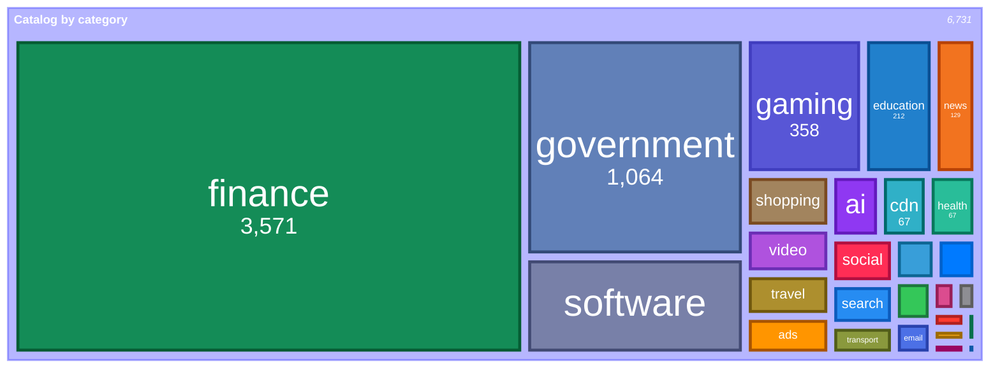
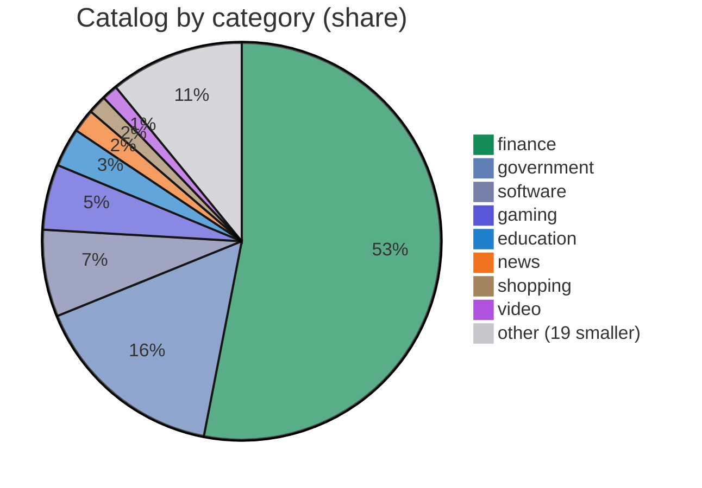
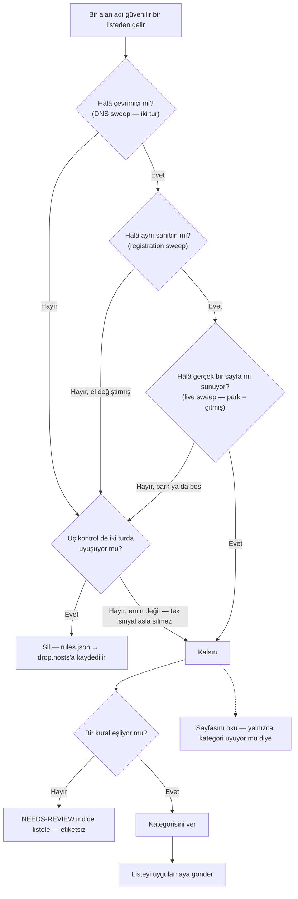
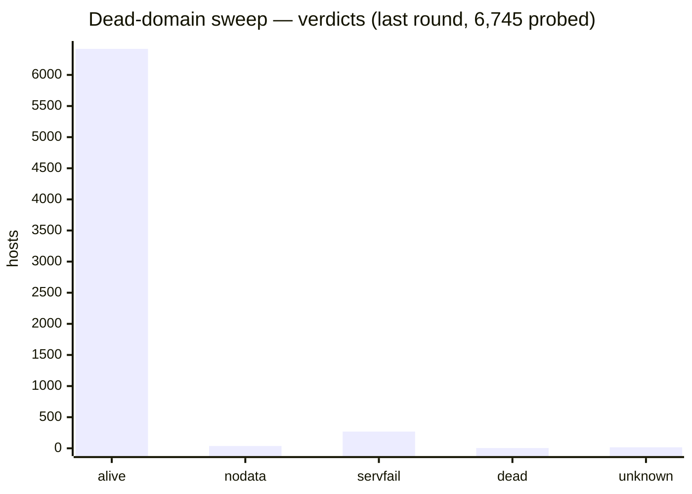
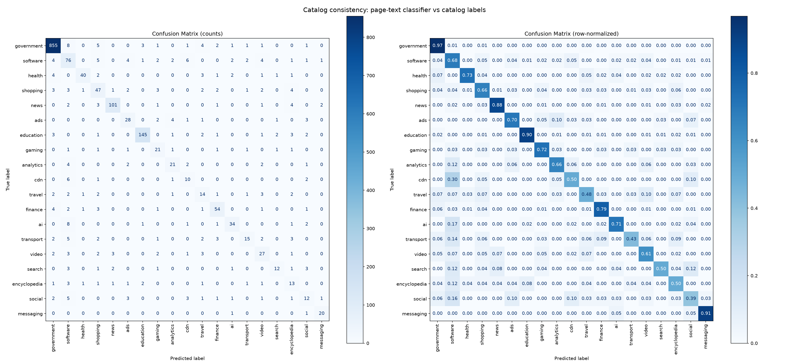

# Net Traffic Control — Catalog

[English](README.md) · **Türkçe**

**Net Traffic Control** için kategori ve servis verisi.

Uygulama bu dosyayı bir **Category Data source** olarak yükler (Settings → Category
Data → Add source). Host adlarını bir **kategoriye** (adın ne olduğu) ve ait
olduğu **servise/ürüne** (kimin olduğu) eşler; böylece Live Traffic ve Allowed
Sites ekranları alan adlarını doğru gruplar ve etiketler.

<!-- catalog-badges:start -->

   

<!-- catalog-badges:end -->

## İçindekiler

- **6,731 host** — `host → kategori`.
- **22 servis** — `ürün → host`.

Kategoriye göre döküm için [`docs/CATALOG.md`](docs/CATALOG.md); analizin ne
kadarını gerçekten okuyabildiği ve hangi kaynağın hangi kategoriyi taşıdığı için
[`docs/COVERAGE.md`](docs/COVERAGE.md).

## İçinde ne var

Kataloğun kategoriye göre dağılımı, bütünün payı olarak — `finance` ve
`government` çoğunluğu oluşturur, uzun kuyruk bilerek küçüktür. Her kategori,
iOS uygulamasının kullandığı renkle çizilir; bu renkler
`reference/category-colors.json`'dan alınır:

<!-- category-treemap:start -->



<!-- category-treemap:end -->

Bu blokları `catalog.json`'dan `scripts/catalog/build-catalog-docs.py` yazar;
onunla yeniden üret.

Bu sayfada iki farklı `other` görünür ve aynı sayı **değildir**: treemap'teki
`other`, literal `other` kategorisidir (14 host); pie'deki `other (19 smaller)`
ise 19 en küçük kategorinin bir arada toplanmasıdır (733 host).

Bütünün payı olarak, uzun kuyruk `other` altında toplanmış:

<!-- category-pie:start -->



<!-- category-pie:end -->

## Akış — listeden kataloğa giren bir alan adı

Bir alan adı güvenilir bir listeden gelir. Yerini koruması için üç bağımsız
kontrolün onu hâlâ çevrimiçi ve hâlâ aynı sahipte bulması gerekir. Kontrollerden
biri emin değilse alan adı kalır — tek bir sinyalle hiçbir şey silinmez ve
silinen bir ad sessizce geri gelemez.



Üç kontrol **bağımsız**dır ve kapı bir **kesiştir**: bir host ancak her kontrol,
iki turda, giderse önerilir. Varsayılan olarak live sweep yalnız `parked` önerir
— boş 200 ya da 404 canlı altyapıda sıradandır (`adnxs.com`,
`3dsecure.akbank.com.tr`). Tam metod, her verdict ve koruma kuralları:
[`docs/PIPELINE.md`](docs/PIPELINE.md).

Karışması kolay iki şey ayrı tutulur:

- **Kategori bir karardır, tahmin değil.** Onu bir kural ya da bir kişi belirler;
  sayfaya asla kategori uydurtulmaz. Hiçbir kuralın eşlemediği bir ad, bir kişi
  için [`docs/NEEDS-REVIEW.md`](docs/NEEDS-REVIEW.md) içinde listelenir.
- **Sayfayı okumak yalnızca bir kontroldür.** Kategorinin sayfayla uyup
  uymadığını ölçer; listeyi asla yazmaz. Düşük skor, etiketin sayfayla
  çeliştiğini söyler; etiketin yanlış olduğunu değil.
- **Her host bir listeden gelmedi.** Bir host üç kapıdan birinden girer — bir
  kaynak, kamu-kurumu tarayıcısı ya da bir kişinin eli — ve son ikisini hiçbir
  kayıt adlandırmaz. Ne bir kuralın ne bir kaynağın getirmediği host'ları
  [`docs/FOUNDING.md`](docs/FOUNDING.md) hesaba katar.

Ortadaki üç kontrol bir sonraki bölümün konusudur. Arkalarındaki araçlar:
[`probe-dead.py`](scripts/catalog/probe-dead.py),
[`verify-registrations.py`](scripts/catalog/verify-registrations.py) ve
[`sweep-live.py`](scripts/analysis/sweep-live.py).

Bir kategorinin nasıl belirlendiği — bir host'un girebileceği üç kapı —
[`docs/INGEST.md`](docs/INGEST.md) içinde. Silme mekanizması — dokuz DNS sorusu,
her verdict ve arkalarındaki koruma kuralları —
[`docs/PIPELINE.md`](docs/PIPELINE.md) içinde; her taramanın ne sıklıkla
çalışması gerektiği ise [`docs/SCHEDULE.md`](docs/SCHEDULE.md) içinde.

## Varlığı nasıl doğrulanır

Bu, bir host'un hâlâ **orada** olduğunu doğrular — çevrimiçi, hâlâ aynı sahibin,
hâlâ bir sayfa sunuyor. **Kategorinin doğru** olduğunu doğrulamaz. Bu ayrı bir
sorudur ve aşağıdaki [Katalog Tutarlılık Analizi](#katalog-tutarlılık-analizi)
tarafından, burada değil, cevaplanır.

Bir host, yalnızca bağımsız taramalar onun gittiğinde anlaştığında silinir; her
host silinmeden önce iki turda yoklanır. Aşağıdaki DNS taraması **Cloudflare**,
**Google** ve **AdGuard**'ın (*filtresiz* uç noktası — varsayılan olan, engelli
reklam/izleyici adlarına `0.0.0.0` yanıtı verir; onunla ölçmek kendi listesini
ölçmek olur) doğrudan `A`, `AAAA` ve `NS` sorar — dokuz soru — on dakika arayla
iki turda; ve yalnızca dokuzunun hepsine **her iki turda da** `NXDOMAIN` yanıtını
veren host ölü sayılır. Her çözümleyici `SERVFAIL` dediğinde tarama, kontrol
devre dışı bırakılmış olarak bir kez daha sorar; böylece bir DNSSEC doğrulama
hatası, hiç çalışmamış bir delegation ile karıştırılmaz. Tarayıcı taraması
(agent-browser + Lightpanda) bir host'un hâlâ ne sunduğuna bakar; kayıt taraması
ise el değiştiren bir adı yakalamak için RDAP/WHOIS/IP kontrol eder.

<!-- verification-status:start -->



<!-- verification-status:end -->

Son tur kendi listesini tarar; bu liste zaten `rules.json → drop.hosts` ile
kaldırılmış host'ları da içerir — bu yüzden toplamı katalogdaki host sayısına eşit
olmayabilir. Tam yöntem, kanıt ve kaldırma politikası:
[`scripts/README.md`](scripts/README.md).

## Format ve bakım

Dosya formatı — şema, eşleşme kuralları, sözlük ve öncelik sırası —
[`docs/FORMAT.md`](docs/FORMAT.md) içinde. Bir host'un nasıl üretileceği,
ekleneceği, düzeltileceği ve kaldırılacağı ile arkasındaki disiplin ise
[`docs/MAINTAINING.md`](docs/MAINTAINING.md) içinde.

Katalog ham hâlde şuradan sunulur:

```
https://raw.githubusercontent.com/mahirfatih/net-traffic-control-catalog/main/catalog.json
```

## Katalog Tutarlılık Analizi

Tek seferlik bir analiz ([`scripts/analysis/`](scripts/analysis/), sonuçlar
[`docs/analysis/`](docs/analysis/)) katalog host'ları için ana sayfa metnini
getirir, dokuz metin sınıflandırıcıyı — sekizi TF-IDF özellikleri üzerinde,
biri çok dilli cümle gömmeleri (sentence embeddings) üzerinde —
karşılaştırır, denetim tanığı olarak LinearSVC'yi tutar ve etiketlerimizin bir
metin modelinin geri kazanabileceğiyle ne kadar tutarlı örtüştüğünü gösteren bir
confusion matrix (karmaşıklık matrisi) çizer.



**Doğruluk: %89** (4,054/4,563, 27 sınıf, 3-fold CV) — **dengeli doğruluk %61**.
`finance` kataloğun %53'üdür; bu yüzden iki sayı 28 puan farklıdır ve anlamlı
olan ikincisidir: bu, sınıf başına ortalama recall'dir; ortalama olarak bir
kategorinin nadir görülen örneklerinde her beş sınıf tanımasından yaklaşık ikisi
kaybolur — doğruluk bunu gizler.

Bu *kendi kendine tutarlılığı* ölçer, doğruluğu değil — etiketlerimizin sayfa
içeriğinden tahmin edilebilir olup olmadığını gösterir. Yüksek köşegen =
etiketlerimiz sayfa metninden öngörülebilir. Köşegen dışı = etiketimiz metnin
ima ettiğiyle çelişir (ya etiket yanlış, ya sayfa kategoriyi temsil etmiyor).

Küçük olanlar dahil 27 kategorinin tamamı ölçülür. Aynı bölmeler üzerinde dokuz
model karşılaştırılır — sekizi TF-IDF bag-of-words özellikleri, biri çok dilli
cümle gömmeleri üzerinde — ve denetim tanığı olarak LinearSVC tutulur:

| model | doğruluk | dengeli doğruluk | macro-F1 | weighted-F1 |
| --- | ---: | ---: | ---: | ---: |
| MultilingualEmbeddingLogReg | 0.852 | 0.666 | 0.585 | 0.866 |
| RidgeClassifier | 0.864 | 0.637 | 0.566 | 0.876 |
| LinearSVC | 0.888 | 0.605 | 0.592 | 0.890 |
| SGDClassifier | 0.889 | 0.584 | 0.589 | 0.889 |
| LogisticRegression | 0.865 | 0.580 | 0.557 | 0.874 |
| RandomForestClassifier | 0.821 | 0.523 | 0.506 | 0.840 |
| KNeighborsClassifier | 0.856 | 0.444 | 0.513 | 0.839 |
| DecisionTreeClassifier | 0.797 | 0.395 | 0.391 | 0.800 |
| MultinomialNB | 0.603 | 0.164 | 0.165 | 0.649 |

Tablo dengeli doğruluğa göre sıralanmıştır ve açıklayıcıdır, bir sıralama
yarışı değildir. LinearSVC tanık olarak kalır: dokuzu içinde en yüksek
macro-F1'e sahiptir ve ilişkili terimler raporunun okuduğu katsayılar onundur.
İki model dengeli doğrulukta onu geçer — `MultilingualEmbeddingLogReg` 0.666 ve
`RidgeClassifier` 0.637; ikisi de macro-F1'den feragat eder — doğrusal olmayan
başlıklar ise seyrek sözcük özelliklerinde geride kalır
(`KNeighborsClassifier` aynı zamanda `class_weight` ile dengelenemeyen tek
modeldir). İlginç olan gömme farkıdır: Türkçe, Almanca, Korece ve Çince
sayfaları tek bir uzaya eşler, böylece bag-of-words'ün ayrı tuttuğu küçük,
İngilizce olmayan kategorileri geri kazanır.

- **En yüksek F1:** `government` 0.97, `finance` 0.96, `education` 0.91, `news`
  0.85 — güçlü, ayırt edici sayfa sinyalleri. (`email` de 0.79 alıyor ama yalnızca
  19 host üzerinden; bu yüzde listede kalmaz, aşağıya bak.)
- **En düşük F1:** `crypto` 0.29, `encyclopedia` 0.31, `cdn` 0.35, `music` 0.40,
  `social` 0.40, `video` 0.41 — bunların bazıları altyapıdır (sayfa metni
  anlamsız ya da belirsiz). İlişkili terimler ve model-ağırlık terimleri olası
  yanlış sınıflandırmaları ortaya koyar.
- **Zayıf kanıt:** sekiz kategori 20'nin altında örneğe sahiptir, bu yüzden
  F1'leri ölçülmüş değil göstergeseldir — `maps` 3, `sports` 7, `music` 8,
  `crypto` 8, `other` 10, `crash` 11, `telecom` 11, `email` 19. `email`'in 0.79'u,
  eğer inceliği göz ardı edilirse "en yüksek" görünürdü — bu yüzde yukarıdaki listeden
  tutulmuştur. Matrisin 5 değil 3-fold olmasının nedeni budur.
- **Kapsam %68 ve dengesiz dağılmış:** 6,731 host'un 4,563'ü kullanılabilir
  sayfa metni üretir. Başarısızlıklar canvas/JS-ağır kategorilerde toplanır —
  `gaming` 358 host'un 69'unda ölçülür (%19), `software` 476'nın 168'i (%35) —
  statik olanlar iyi yapar (`government` %87, `news` %89). Her sınıf-içi skor,
  kategoriyi değil metin üreten host'ları tanımlar. Tam tablo
  [`docs/analysis/README.md`](docs/analysis/README.md) içinde.
- **Yüksek güvenli hatalar:** 69 host — model ≥%70 emin ve etiket ayrışıyor.
  Liste, matris gibi fold dışında hesaplanır; önce listelediği beşi
  (`guven.com.tr` `finance` → `health` %85, `display.ugc.bazaarvoice.com`
  `software` → `finance` %82, `iqiyi.com` `video` → `finance` %82,
  `googlesyndication.com` `ads` → `search` %83, `ilbank.gov.tr` `finance` →
  `government` %87) hâlâ orada; yanlarına örnek-içi olasılıkların sakladığı
  host'lar eklendi. 69'un 57'si `finance` tahmin ediyor — etiket kataloğun
  %53'ü ve modelin geri düşüşü. Tam liste
  [`docs/analysis/out/high-confidence-errors.md`](docs/analysis/out/high-confidence-errors.md)
  içinde.

Tam metodoloji, sınıf-başına metrikler, ilişkili terimler (chi-squared +
LinearSVC ağırlıkları) ve hata listesi için
[`docs/analysis/README.md`](docs/analysis/README.md).

## Lisans

Bu depodaki veri **CC0 1.0 Universal** altında kamu malına adanmıştır. Bkz.
[LICENSE](LICENSE).
