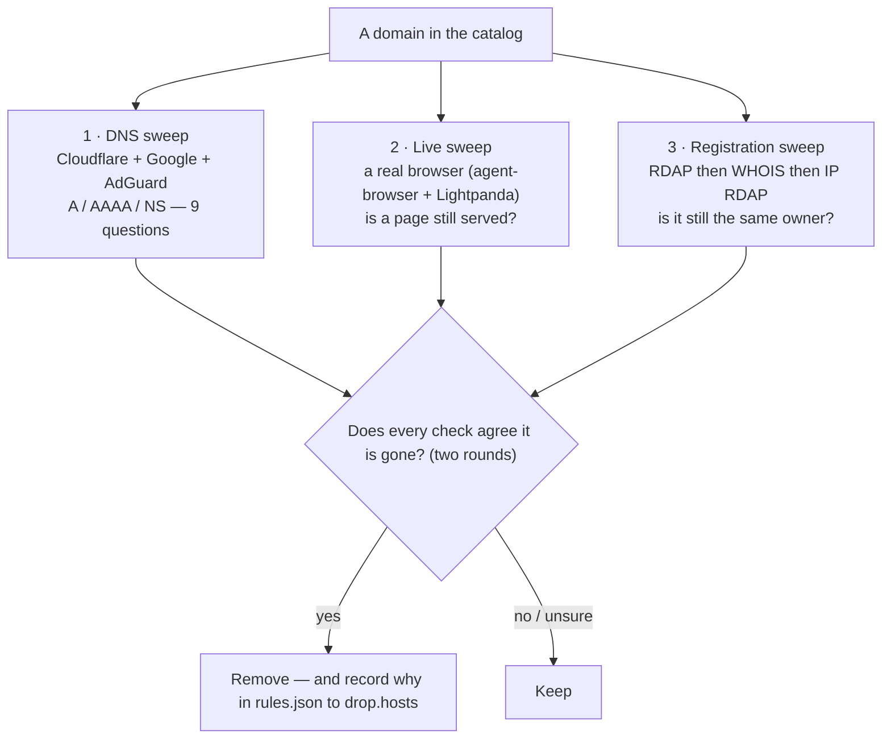

# Pipeline — how a domain leaves

A domain *enters* the catalog through one of three doors — a source, the
public-institution harvester, or a person's hand (`INGEST.md`). This page is the
other half: once a host is in, how does it get out? Every host in the catalog
goes through three independent checks. Each asks a
different question, runs its own tool, and a host is only removed when every
round of every check agrees it should go. This is the machinery behind the
README's [“Pipeline — from a list to a kept host”](../README.md#pipeline--from-a-list-to-a-kept-host).
How a host got *in* is [`INGEST.md`](INGEST.md).

The three checks are independent on purpose: a name can be alive in DNS, serving
nothing, and still registered to its owner, and only the last of those is a
reason to remove it. A run of each is cached under [`../evidence/`](../evidence/README.md)
so a verdict can be read without the network.

## 1 · DNS sweep — is it still there?

[`scripts/catalog/probe-dead.py`](../scripts/catalog/probe-dead.py) asks
**Cloudflare**, **Google** and **AdGuard** (its *unfiltered* endpoint, because
the default one answers blocked ad and tracker names with `0.0.0.0`) directly
about three record types: **A, AAAA, NS** — nine questions per host, per round.
A host is only `dead` when **all nine** answer NXDOMAIN in **both** rounds; the
system resolver cannot make this call, because it cannot tell a dead name from a
name this network cannot reach.

| verdict | meaning | removed? |
| :--- | :--- | :--- |
| `dead` | every one of the nine questions answers NXDOMAIN, in both rounds | **yes** |
| `alive` | at least one resolver answers with a record | no |
| `nodata` | the name exists but has no address record | no |
| `servfail` | the zone is broken — DNSSEC validation, or a lame delegation; the sweep asks again with checking disabled and records which | no |
| `unknown` | the sources disagree, or the network failed | no |

`nodata` and `servfail` are reported, never proposed — 181 real banks were
almost dropped on `nodata` alone.

## 2 · Live sweep — does it still serve?

[`scripts/analysis/sweep-live.py`](../scripts/analysis/sweep-live.py) visits
each host with a real browser ([agent-browser](https://github.com/vercel-labs/agent-browser)
driving [Lightpanda](https://lightpanda.io)), because a fetch that does not run
JavaScript sees an empty shell where a modern page lives. It records the status,
final URL, title and text length it saw.

| verdict | meaning | removed? |
| :--- | :--- | :--- |
| `parked` | a registrar parking page ("Buy this domain", HugeDomains) | **yes** |
| `empty` | a page with no usable text | only with `--aggressive` |
| `no-http` | a 404 or a server error | only with `--aggressive` |
| `blocked` | the site refuses automated traffic | no |
| `content` | a real page with text | no |
| `tls-error` / `timeout` / `dns-error` | the network, not the host | only with `--include-flaky` |
| `harness-error` | the browser itself failed | never |

By default only `parked` is proposed: a 404 or an empty 200 is common on live
infrastructure (`adnxs.com`, `3dsecure.akbank.com.tr`).

## 3 · Registration sweep — same owner?

[`scripts/catalog/verify-registrations.py`](../scripts/catalog/verify-registrations.py)
checks the registration itself, because a lapsed name can be re-registered by
someone else and inherit the previous owner's category. Four sources, in order:

1. **RDAP** (RFC 7480-7484) via the IANA bootstrap registry, a bundled verified
   supplement for country-code registries IANA omits, and convention probing.
2. **Port-43 WHOIS** for registries with no RDAP (DENIC for `.de`, TRABIS for
   `.tr`, and anything IANA refers to).
3. **IP RDAP** for the host's address block, so the network owner is on record
   alongside the name owner.
4. **traceroute** as a bounded, opt-in reachability diagnostic — never a gate.

| verdict | meaning | removed? |
| :--- | :--- | :--- |
| `gone` | released — a genuine RDAP "not found", `pendingDelete`, `redemptionPeriod` | **yes** |
| `expired` | the registration's expiry date is in the past | **yes** |
| `recently_registered` | a fresh creation date — possibly recycled | only with a flag |
| `review` | registered but not delegated (`inactive`, `clientHold`) | only with a flag |
| `registered` | a live registration | no |
| `unsupported` | no RDAP and no readable WHOIS (`.tr` on policy grounds) | no |
| `unknown` | every source failed or disagreed | no |

`inactive` and `clientHold` are a `review`, not a removal: the name is still
held by its owner, it just is not serving. A name that still resolves in DNS is
never `gone`, whatever a registry status suggests.

## Four rules that govern every check

- **Canary first.** A probe proves the engine works before the sweep runs. A
  broken engine voids the round; it never looks like `dead`.
- **Two rounds.** At least ~10 minutes apart. A verdict needs both rounds to
  agree — one is never enough.
- **Intersection.** A host is proposed only if every round of every check
  agrees. Live sites are never removed on a single signal.
- **Logged removal.** Every removal is written to `rules.json → drop.hosts`
  with its reason. A removal cannot quietly undo itself, and a host with a
  removal entry is not allowed back into the seeds without one.

## The states are kept apart on purpose

The three sweeps answer different questions, so their verdicts are different
words for different facts. Collapsing them into one "up/down" flag is how a
lapsed-but-alive name gets deleted. Keep these six distinct, and let the removal
policy — not a single verdict — decide:

| State | Which check | Meaning | Removed? |
| :--- | :--- | :--- | :--- |
| `dns_unresolved` | DNS | the name does not resolve at all (`NXDOMAIN` to all nine) | only as `dead`, two rounds |
| `registration_expired` | registration | the registration's expiry date is in the past | **yes** |
| `ownership_changed` | registration | `gone` / a new owner on record | **yes** |
| `http_unavailable` | live | no response, a 404, or an empty page | only `parked` by default |
| `parked` | live | a registrar parking page | **yes** |
| `confirmed_retired` | all three | every check agrees, in two rounds | **yes** |

`NXDOMAIN` is DNS evidence, not a removal reason on its own: a name can stop
resolving while its owner still holds it, and a subdomain can be dropped while
the registrable domain and its company stay up. Only the intersection — every
check, both rounds — produces `confirmed_retired`.

## When it runs

None of this runs in `test/test.sh`: the sweeps need the network and a browser.
The cadence each one should keep — weekly DNS, monthly live, quarterly
registration — and why they differ is in [`SCHEDULE.md`](SCHEDULE.md).
