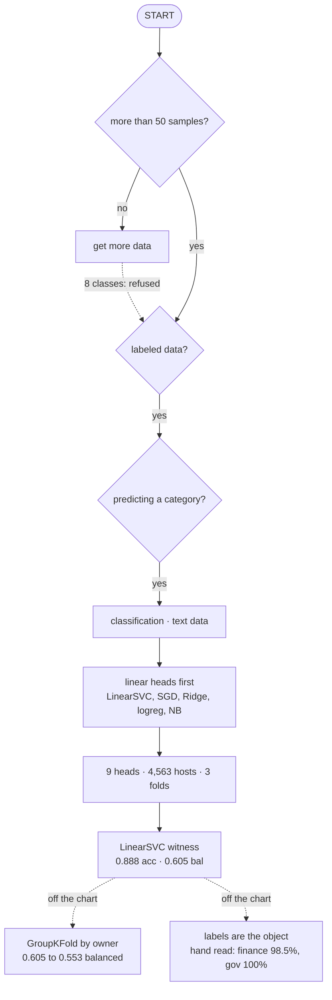

# Method — why this model, answered against the estimator map

[`README.md`](README.md) reports the numbers. This page is the **why**: it walks
this catalog through scikit-learn's own
[estimator selection guide](https://scikit-learn.org/stable/machine_learning_map.html)
— the flowchart of "which model should I try" — and records where the chart
decides for us, where it decides against us, and where we leave it on purpose.

The chart is a live interactive SVG on scikit-learn's site (© scikit-learn
developers, BSD). Rather than copy it in, the path **this audit** takes is drawn
below, annotated with the numbers the run actually produced. The numbers live in
[`out/matrix-data.json`](out/matrix-data.json); every one of them is reproducible
from the commands at the bottom.

## The path we take



**Every dotted arrow leaves the chart**, and the three of them are the three
sections that follow: the *get more data* exit we refuse, the grouped split the
chart has no box for, and the labels that are the object of the audit rather
than its ground truth.

## Every gate the chart asks, answered

| The chart asks | This catalog | What it changed |
| :--- | :--- | :--- |
| **">50 samples"** — and a no leads to *"get more data"* | 4,563 hosts overall, but `maps` has **3**, and eight classes sit under 20 | we refuse the exit: the class is kept and the fold count drops to 3 |
| **"do you have labeled data"** | yes — the catalog's own 27 categories | this is the load-bearing assumption, and testing it is the point of the audit |
| **"predicting a category"** | yes, 27 of them | classification; the clustering, regression and dimensionality-reduction branches never open |
| **"text data"** | homepage text, TF-IDF 1–2 grams over 20k features (`min_df=2`, `sublinear_tf`) | sparse and high-dimensional — exactly the linear heads' case |
| **"<100K samples"** | 4,563 | nothing is ruled out by size; every estimator the chart offers is reachable |

The chart's **"TRY NEXT"** arrows matter as much as its boxes: it is an ordered
suggestion, not a verdict, and this run is the proof. Two heads beat the witness
on balanced accuracy — the embedding head at 0.666 and `RidgeClassifier` at
0.637 — and both cost macro-F1. The witness stays for what it is read for, not
for the highest number in the table.

## Where we leave the chart

### 1. "Get more data" is refused, on purpose

The chart's first gate is a hard **no** for eight of the twenty-seven classes:
`sports` 7, `music` 8, `crypto` 8, `other` 10, `crash` 11, `telecom` 11,
`email` 19, `maps` 3. On its advice the audit would not measure them at all —
which is exactly how nine categories stayed unmeasured for its entire history.

So the class is kept and the cost is **priced rather than hidden**: the fold
count drops to 3 so every class is present in every split, those eight are listed
as `thin_classes`, and their F1 is published as indicative. A category dropped
for being small is a category the audit silently cannot fail on.

### 2. The labels are the object, not the ground truth

The chart assumes labeled data you trust. Here the labels **are** what is being
audited: the model is a witness, not a predictor, so the report leads with
**balanced accuracy** (0.605) rather than accuracy (0.888) — the majority class
is 53% of the catalog and makes the second number close to meaningless on its own.

That is also why [`precision.md`](precision.md) exists. A score computed on the
catalog's own labels cannot certify those labels, so a fixed, seeded sample of
300 hosts (200 finance, 100 government) is read against its cached homepage text
and judged independently of the classifier: finance **98.5%** (95.7–99.5%),
government **100%** (96.3–100%). See [`finance-triage.md`](finance-triage.md) for
what the model's confident disagreements turned out to be.

### 3. The chart has no notion of a grouped split

`StratifiedKFold` puts two hosts of the same owner in different folds, so the
model can memorise one to score the other. The same pipeline is therefore re-run
under `GroupKFold`, every host grouped by its registrable domain (eTLD+1, 4,535
groups). Balanced accuracy drops **0.605 → 0.553** while raw accuracy barely
moves (0.888 → 0.884) — the majority class absorbing the difference. Read the
balanced number as the one that still includes a little owner signal.

## What the chart gets right

Sparse lexical features and 4,563 samples is the linear case, and the run says
so in its own numbers:

| Head | Balanced accuracy | Note |
| :--- | ---: | :--- |
| `MultilingualEmbeddingLogReg` | 0.666 | not the chart's branch — sentence embeddings, not TF-IDF |
| `RidgeClassifier` | 0.637 | linear |
| `LinearSVC` | 0.605 | linear — **the witness** |
| `SGDClassifier` | 0.584 | linear, hinge loss — the same family |
| `LogisticRegression` | 0.580 | linear |
| `RandomForestClassifier` | 0.523 | |
| `KNeighborsClassifier` | 0.444 | the one head with no `class_weight` |
| `DecisionTreeClassifier` | 0.395 | |
| `MultinomialNB` | 0.164 | accuracy 0.603 — can only guess the dominant class |

Four of the top five are linear heads on TF-IDF, and the chart's own *Ensemble
Classifiers* branch — represented here by `RandomForestClassifier` at 0.523 —
sits below every one of them. Naive Bayes earns its place on the chart's list by
failing informatively: with the rare classes reweighted to roughly 800:1 it
scores 0.603 accuracy and 0.164 balanced, which is a model that can only guess
the majority class, **measured rather than inferred**.

## Reproduce it

```bash
cd scripts/analysis
python3 -m venv .venv && .venv/bin/pip install -r requirements.txt
.venv/bin/python fetch-pages.py    # cache each host's homepage
.venv/bin/python build-matrix.py   # writes out/
```

`requirements.lock` pins the environment that produced the committed `out/`. The
full list of what each pass computes is in [`README.md`](README.md); the shipped
catalog pipeline never runs any of this — the rest of `scripts/` is
standard-library-only by design.
