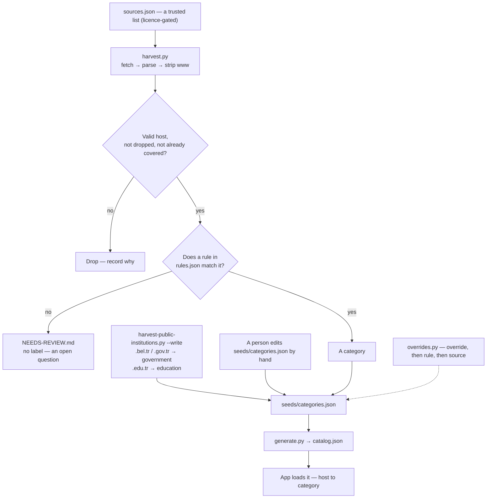

# Ingest — how a domain gets a category

Every host in `catalog.json` arrived through **one of three doors**, and only a
person or a rule ever decides its category — no script invents one. This page is
the mirror of [`PIPELINE.md`](PIPELINE.md): that page follows a domain *out* (is
it still there, still the same owner, still serving), this one follows it *in*.



## The three doors

| Door | How a host comes in | What sets its category |
| :--- | :--- | :--- |
| **1. A source list** | `scripts/sources/harvest.py` fetches a licence-gated list from `sources.json`, parses it, drops what the catalog already covers, and applies `rules.json` | a rule in `rules.json` — or nothing, in which case the host is not imported |
| **2. The public-institution harvester** | `scripts/sources/harvest-public-institutions.py --write` reads curated Turkish public-directory pages | the closed suffix: `*.bel.tr` / `*.gov.tr` → `government`, `*.edu.tr` → `education` |
| **3. By hand** | a person writes a line into `seeds/categories.json`, and records who/when/why in [`seeds/hand-added.json`](../../seeds/hand-added.json) | that person |

Plus one correction layer: `scripts/catalog/overrides.py` writes
`rules.json → drop.override`, the single-host decision that beats every rule and
every source. It is not a door — it edits a host that is already in.

## Door 3 leaves a paper trail

Doors 1 and 2 carry their own provenance — a source is named in `sources.json`
with its licence, and a public-institution host is explained by its closed
suffix. Door 3 is the one that used to record nothing: a line in
`seeds/categories.json` is a bare `host → category`, with no author, no date and
no reason. That is the gap a wrong label gets lost in.

So a host a person adds by hand also gets a record in
[`seeds/hand-added.json`](../../seeds/hand-added.json):

```json
{ "example.com": { "by": "github-handle", "at": "2026-10-18",
                   "reason": "a real site in this category" } }
```

`by`, `at` and `reason` are all mandatory, and the host must already be in
`seeds/categories.json` — this file records *who added it*, it is not a second
list of hosts. `scripts/catalog/check-hand-added.py` enforces it, and
`./test/test.sh` and `check-docs-fresh.mjs` both run it.

It is not retroactive. The founding-era hosts are counted in
`evidence/seeds-only.json`; git knows *when* they arrived but not *why*, so they
stay unattributed here until a reason is verified for each.

## A source list carries names, not categories

This is the part that is easy to get wrong. A source from `sources.json` is a
list of **host names only**. It says nothing about what a host *is*. The category
appears from one of two things, and neither of them is the source:

- a **rule** in `rules.json` — a person wrote `{ "match": [...], "category":
  "...", "note": "why" }`, and the first matching rule wins;
- a **person**, who typed the line into `seeds/categories.json` directly.

A host that no rule matches is **not** guessed at. It is written to
[`NEEDS-REVIEW.md`](NEEDS-REVIEW.md) as an open question and left out of the
catalog, because a wrong label looks authoritative and nobody can tell it was
never checked. `other` is never a default either: `harvest.py` will not write it,
because `other` means "a person looked and did not know".

## What the harvest will never do

From the header of `scripts/sources/harvest.py`, on purpose:

- **Invent a category.** No rule, no label — the host goes to `NEEDS-REVIEW.md`.
- **Write `other` automatically.** `other` means a person looked and did not know.
- **Overwrite a label.** A conflict is printed; the seed wins.
- **Overwrite an override.** A host in `drop.override` was decided by a person;
  a source has no standing against it.
- **Drop a line it does not understand.** A parser that skips silently is how a
  catalog goes quietly wrong.

## Category precedence

The order is fixed and written down so a source refresh can never quietly undo a
review:

```
override  >  rules  >  harvested source
```

`generate.py` applies overrides last; `merge.py` refuses to overwrite an
overridden host; the audits treat an override as deliberate. See
[`SOURCES.md`](../reference/SOURCES.md) for the harvest in full and
[`../scripts/README.md`](../../scripts/README.md) for the commands.

## How much of the catalog came from where

The three doors are not equally sized. Measured over the committed catalog
(`evidence/seeds-only.json`, kept current by
`scripts/catalog/seeds-provenance.py`):

| Origin | Hosts |
| :--- | ---: |
| Matched by a rule (`rules.json`) | 4,451 |
| Named by a source (`sources.json`) | 126 |
| **Neither** — the public-institution door | 1,233 |
| **Neither** — typed by hand | 921 |

That last pair is the interesting one: **2,154 of the 6,731 hosts come from
neither a rule nor a source.** Most of them (1,233) are Turkish public bodies
imported by the suffix harvester; the remaining 921 were entered by hand. They
are the catalog's founding layer, and [`FOUNDING.md`](../overview/FOUNDING.md) accounts for
them.
