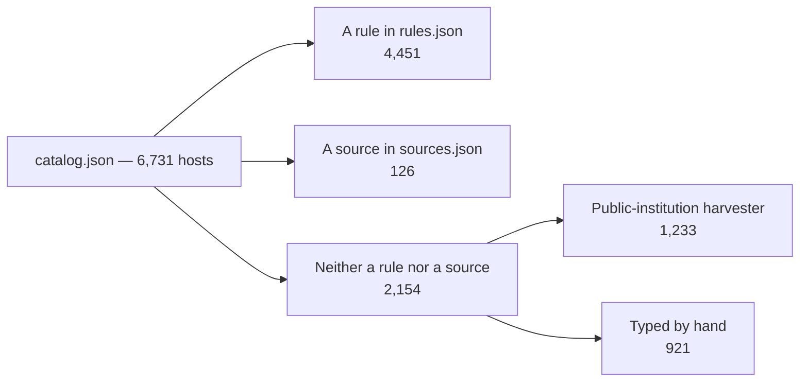

# Founding — the hosts that came from no source

Most of this catalog can be traced to a rule or a source: ask why a host says
`video` and the answer is a `rules.json` entry or a list in `evidence/`. This
page is about the hosts where **the answer is neither** — the ones that were
already here when the harvesting machinery was built. They are the catalog's
founding layer, and until this page existed nothing recorded that.

A host is *unattributed* when no rule in `rules.json` matches it **and** no list
in `sources.json` named it (or one of its subdomains). "Coming from a source"
does not mean the source carried a category — sources never do; see
[`INGEST.md`](../guides/INGEST.md). It only means the host's *name* arrived that way.

## The number

Of the **6,731** hosts in `catalog.json`:

| Origin | Hosts |
| :--- | ---: |
| Matched by a rule in `rules.json` | 4,451 |
| Named by a source in `sources.json` | 126 |
| **Neither** — imported by the public-institution harvester | 1,233 |
| **Neither** — typed into `seeds/categories.json` by hand | 921 |
| **Total unattributed** | **2,154** |



The 2,154 split in two, and the split matters:

- **1,233 are not hand-typed.** They are the closed Turkish public suffixes
  (`*.bel.tr`, `*.gov.tr` → `government`; `*.edu.tr` → `education`) written by
  [`harvest-public-institutions.py`](../../scripts/sources/harvest-public-institutions.py).
  That script is a door of its own — not a `sources.json` list, not a rule — so
  its hosts land here. The suffix *is* the evidence.
- **921 are hand-entered.** A person looked at the host and wrote the line.
  These are the oldest layer of the catalog.

## The original list

`seeds/categories.json` was created in commit **`9aa36a3`** on **2026-10-10**
with **1,116** hosts — before any source was harvested. Of those:

| | Hosts |
| :--- | ---: |
| In the first commit | 1,116 |
| Still in the catalog | 1,101 |
| Still unattributed (no rule, no source) | 903 |
| Since matched by a rule or a source | 198 |

Those 1,116 rows are the list the catalog began as. 1,101 survived; 903 of them
were never attached to a rule or a source and are still the hand-entered core.

## Where the list itself lives

The full, current list is committed as **machine-readable evidence**, not as
markdown, so it cannot drift from the data it describes:

- [`evidence/seeds-only.json`](../../evidence/seeds-only.json) — every unattributed
  host (the 921 hand-entered ones verbatim, with the counts and the founding
  block), regenerated by `scripts/catalog/seeds-provenance.py`.
- `docs/guides/NEEDS-REVIEW.md` is the *other* side of the same coin: hosts a source
  offered that no rule matched, still waiting for a decision. A host in this page
  already has a category; a host in `NEEDS-REVIEW.md` does not.

Regenerate and verify:

```sh
python3 scripts/catalog/seeds-provenance.py          # write evidence/seeds-only.json
python3 scripts/catalog/seeds-provenance.py --check   # fails if the file is stale
```

`check-docs-fresh.mjs` runs the `--check` form, so the counts on this page cannot
go quietly out of date. The numbers here are read from that file, not typed in
by eye.

## Why this is worth a page

Without it, the honest sentence "every host came from a source" is **false for
2,154 of 6,731 hosts** — and nothing in the repository said so. A provenance
claim a reader cannot check is a claim that will one day be wrong. This page and
its JSON make the claim checkable: a name is attributed if a rule or a source
names it, and the file lists the rest.
